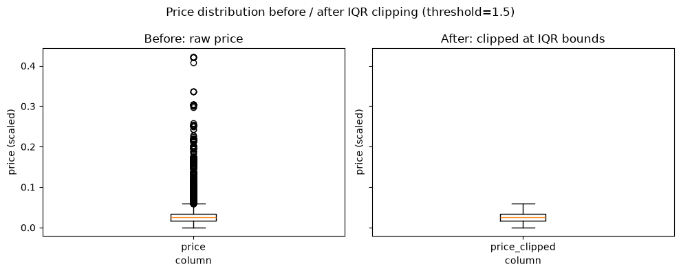
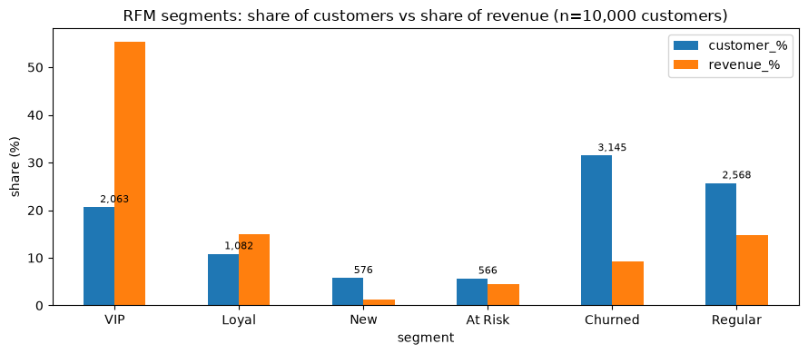

# A1-1 - 쇼핑몰 단골 찾기 (ecommerce-rfm)

이커머스 데이터(수치·텍스트·범주·날짜·이미지 배열)를 NumPy 벡터 연산으로 처리하는
`DataAnalyzer` 파이프라인을 만들고, EDA·IQR 이상치 탐지·그룹별 결측 대치·6종 시각화를 거쳐
RFM(Recency·Frequency·Monetary, 최근성·빈도·금액)으로 고객을 6개 세그먼트로 나눠 데이터 근거가 있는 전략을 제안한다.

- 과제 원문: 로컬 `../a1-1-ecommerce-rfm.md`
- AI 심화 학습 · 데이터 분석 · 60시간 · 필수 · 개인
- Python 3.12 이상 (과제 조건은 3.8 이상 — 고정한 `numpy==2.5.4` 가 3.12 를 요구한다)

## 결과 요약

- H&M 거래 12개월(2019-09-23 ~ 2020-09-22)에서 고객 1만 명을 뽑아, 그 고객의 거래 **149,548줄**을 상품·고객 정보와 결합했다.
- 상품 사진 1,000장을 `(1000, 175, 63, 3)` 배열 하나로 쌓아 사진마다 도는 반복문 없이 평균·표준편차 피처를 만들었다.
- RFM 세분화 결과 **VIP 20.6% 가 매출의 55.4%** 를 내고, 1회 고객이 34.5%, 단골이었다가 멈춘 At Risk 가 566명이다 → [비즈니스 인사이트](#비즈니스-인사이트)
- 노트북의 실행 결과(표·차트·해석)는 [`notebooks/analysis_report.md`](notebooks/analysis_report.md) 에서 텍스트와 그림 파일로도 볼 수 있다.

## 프로젝트 구조

```
a1-1-ecommerce-rfm/
├── src/
│   ├── pipeline.py           # DataAnalyzer 클래스 + iqr_bounds·summary_stats·correlation_pairs
│   └── extract_images.py     # 전체 zip 에서 표본 상품 사진 n장만 꺼내기
├── notebooks/
│   ├── analysis_report.ipynb # 분석 리포트 (1~5장, 실행 결과 포함)
│   ├── analysis_report.md    # 위 노트북의 실행 결과 Markdown 사본 (nbconvert 로 생성)
│   └── analysis_report_files/ # 사본이 쓰는 차트 그림 8장
├── requirements.txt
└── data/                     # git 제외 — raw/(CSV·zip), images/(사진 1,000장)
```

## 설치 및 실행

```bash
# 1) 환경
uv venv --python 3.12 .venv && source .venv/bin/activate
uv pip install -r requirements.txt   # uv 가 없으면 python -m venv .venv 후 pip install -r requirements.txt

# 2) 데이터 — 아래 "데이터" 절의 방법으로 data/raw/ 에 CSV 3개와 전체 zip 을 둔 뒤, 표본 상품 사진만 꺼낸다
python -m src.extract_images         # 기본 1,000장·random_state=42 → data/images/

# 3) 노트북 — 열어서 보거나, 처음부터 끝까지 다시 실행
jupyter lab notebooks/analysis_report.ipynb
jupyter nbconvert --to notebook --execute --inplace notebooks/analysis_report.ipynb
jupyter nbconvert --to markdown notebooks/analysis_report.ipynb   # Markdown 사본·그림 파일 갱신
```

- `requirements.txt` 는 버전을 `==` 로 고정했다. `jupyterlab`·`ipykernel` 은 노트북 실행용이고 분석 코드에서는 쓰지 않는다.
- 표본은 저장하지 않고 `load_data()` 가 매번 원본에서 거른다. 원본 3.49GB 를 덩어리로 읽어 약 9초, 최대 메모리 약 2.2GB 가 든다. 노트북 전체 실행은 약 20초다.
- 고객 표본·사진 표본은 `random_state=42` 로 고정돼 있어 다시 실행해도 같은 고객·같은 사진이 뽑힌다.

## 실행 검증

```bash
$ jupyter nbconvert --to notebook --execute --inplace notebooks/analysis_report.ipynb; echo "exit=$?"
[NbConvertApp] Converting notebook notebooks/analysis_report.ipynb to notebook
[NbConvertApp] Writing 511340 bytes to notebooks/analysis_report.ipynb
exit=0
```

| 확인 (2026-11-25 실행) | 결과 |
|---|---|
| 셀 | 79개 (코드 42 · 마크다운 37) |
| 출력이 있는 코드 셀 | 41 / 42 (출력이 없는 1개는 import 셀) |
| 오류 출력 | 0 |
| 차트 그림 | 8장 (`notebooks/analysis_report_files/`) |
| 데이터 결합 | 149,548줄 × 23열, 상품·고객 결합 누락 0 (노트북 1장 `load_summary`) |
| 실행 시간 | 약 20초 (그중 `load_data()` 약 9초) |

## 데이터 (과제 §4-1·§7)

| 조건 | 기준 |
|---|---|
| 규모 | 1,000건 이상 · 8개 이상 컬럼 |
| 유형 | 수치형·범주형·날짜형·이미지(배열) 중 3가지 이상 |
| RFM 거래 데이터 | `customer_id`, `order_date`, `amount`(또는 price*qty) |
| 출처 | Kaggle·AI Hub 등 공개 라이선스 우선, **출처 명시 필수** |

### 사용 데이터셋

**H&M Personalized Fashion Recommendations** (Kaggle 대회 데이터)
— https://www.kaggle.com/competitions/h-and-m-personalized-fashion-recommendations/data

| 파일 | 크기 | 행 수 | 열 수 | 주요 열 |
|---|---|---|---|---|
| `transactions_train.csv` | 3.49GB | 31,788,324 | 5 | `t_dat`, `customer_id`, `article_id`, `price`, `sales_channel_id` |
| `articles.csv` | 36.1MB | 105,542 | 25 | `article_id`, `prod_name`, `product_type_name`, `colour_group_name`, `detail_desc` 등 |
| `customers.csv` | 207MB | 1,371,980 | 7 | `customer_id`, `age`, `club_member_status`, `fashion_news_frequency` 등 |
| `images/` | — | 105,100장 | — | 상품 사진(`article_id` 별 JPG). 표본 상품 중 1,000장만 쓴다 |

- **라이선스**: Kaggle 대회 규칙(Competition Rules)을 따른다. 재배포가 금지돼 있어 원본·가공본·사진 모두
  레포에 올리지 않고(`.gitignore` 의 `data/`), 노트북에도 상품 사진을 그림으로 넣지 않았다.
- **받는 방법**: Kaggle 에 로그인해 대회 규칙에 동의한 뒤, Data 탭에서 CSV 3개를 내려받아 `data/raw/` 에 푼다.
  사진은 Data 탭의 Download All(전체 zip, 약 30.8GB)을 `data/raw/h-and-m-personalized-fashion-recommendations.zip`
  으로 두면 `python -m src.extract_images` 가 표본 상품 사진만 꺼낸다.

### 분석 표본

| 항목 | 기준 |
|---|---|
| 기간 | 최근 12개월 2019-09-23 ~ 2020-09-22 (기간 내 14,898,423줄·고객 994,320명) |
| 고객 | 기간 내 구매 고객 중 무작위 1만 명, 그 고객의 기간 내 거래는 **전부** — 줄을 뽑으면 고객마다 F·M 이 줄어든다 |
| 결합 | 거래 줄 단위로 상품(이름 열 13개)·고객(5개) 정보를 왼쪽 결합 → 149,548줄 × 23열, 결합 누락 0 |
| 사진 | 표본 고객이 산 상품 27,783개 중 사진이 있는 상품에서 무작위 1,000장 |
| 중복 줄 | 지우지 않는다. 수량 열이 없고 같은 상품을 여러 개 사면 같은 줄이 반복된다(Kaggle 데이터 설명) |
| `price` | 대회 측에서 축소한 값이라 금액은 상대 비교로만 해석한다 |

| 데이터 유형 (과제 §4-1) | 열 |
|---|---|
| 수치형 | `price`, `age`, 파생 `prod_name_length`·`img_mean`·`img_std` |
| 범주형 | `index_group_name`, `product_type_name`, `garment_group_name`, `club_member_status` 등 |
| 날짜형 | `t_dat` (거래일) |
| 텍스트 | `prod_name`, `detail_desc` |
| 이미지(배열) | 상품 사진 → `plt.imread` NumPy 배열 |
| RFM 컬럼 | `customer_id` = customer_id, `t_dat` = order_date, `price` = amount |

## DataAnalyzer 파이프라인

거래 줄 단위 표 하나(`self.df`)를 들고 단계를 차례로 적용한다. 주요 파라미터는 전부 메서드 인자다.

| 메서드 | 하는 일 | 주요 인자 |
|---|---|---|
| `load_data()` | CSV 3개 → 기간 필터·고객 표본·결합 | 경로 3개, `start_date`·`end_date`, `n_customers`, `random_state` |
| `add_text_features()` | 상품명 단어 수·글자 수 (`.str` 로 열 전체 한 번에) | `col` |
| `add_image_features()` | 사진 → `[::step, ::step]` 다운샘플 → 가운데 자르기 → 4차원 배열 → `mean/std(axis=(1,2,3))` | `image_dir`, `step` |
| `handle_missing_values()` | 표시 열 빈칸 0, 범주 빈칸 `UNKNOWN`, `age` 는 그룹별 중앙값(고객 1명 = 1표) | `strategy`, `target_col`, `group_cols`, `unit_col` |
| `detect_outliers()` | IQR(Interquartile Range, 사분위 범위) 경계 밖 줄 | `column`, `threshold` |
| `clip_outliers()` | 경계값으로 자른 새 열(`price_clipped`), 원본 유지 | `column`, `threshold` |
| `customer_table()`·`product_table()` | 거래 줄 → 고객·상품 단위 표 (중복 집계 방지) | `customer_col`·`article_col`, `amount_col` |
| `monthly_sales()` | 월별 매출, 기간 첫·끝 반쪽 달 제외 | `full_months_only` |
| `calculate_rfm()` | 고객별 R·F·M 값과 1~5점 | `customer_col`, `date_col`, `amount_col`, `reference_date`, `n_quantiles`, `f_bins` |
| `segment_customers()` | `SEGMENT_RULES` 를 위에서부터 적용해 세그먼트 배정 | `rules`, `default` |
| `segment_summary()` | 세그먼트별 고객 수·비중, R·F·M 중앙값, 매출 비중, 평균 단가 | — |

메서드 이름은 과제 §4-2 의 필수 메서드 목록과 §8 예시 골격의 이름(`load_data()`·`handle_missing_values()`·`detect_outliers()`·`calculate_rfm()`)을 그대로 따랐다.

### RFM 정의와 세그먼트 규칙

- **Recency**: 기준일 2020-09-22(데이터 마지막 거래일) − 마지막 구매일. **Frequency**: 주문 수(주문 1건 = 같은 고객 + 같은 날짜). **Monetary**: 원본 `price` 합계.
- **점수**: R·M 은 5분위(20%씩). F 는 1회 고객이 34.5% 라 5분위 경계가 겹치므로 고정 구간 1회 / 2회 / 3~4회 / 5~9회 / 10회 이상.
- **F 를 고정 구간으로 둔 근거**: 주문 수가 1회 34.5%, 2회 16.1% 로 작은 값에 몰려, 5분위 경계가 `[1, 1, 2, 3, 7, 86]` 으로 0%·20% 지점이 겹친다(`pd.qcut` 오류 `Bin edges must be unique`, 노트북 5-1). 그래서 1회·2회는 각각 한 점수로 두고(재구매 여부가 가장 큰 구분), 3회 이상은 R·M 의 20% 와 비슷한 크기가 되게 3~4회(18.0%)·5~9회(20.1%)로 묶고, 나머지를 10회 이상(11.4%)으로 했다.

| 순서 | 세그먼트 | 조건 | 고객 수 (%) | 매출 % | R·F 중앙값 |
|---|---|---|---|---|---|
| 1 | VIP | R ≥ 4, F ≥ 4, M ≥ 4 | 2,063 (20.6) | 55.4 | 19일 · 9회 |
| 2 | Loyal | F ≥ 4 | 1,082 (10.8) | 15.0 | 82일 · 6회 |
| 3 | New | R ≥ 4, F = 1 | 576 (5.8) | 1.3 | 25일 · 1회 |
| 4 | At Risk | R ≤ 2, F ≥ 3 | 566 (5.7) | 4.4 | 180일 · 3회 |
| 5 | Churned | R ≤ 2, F ≤ 2 | 3,145 (31.5) | 9.2 | 234일 · 1회 |
| 6 | Regular | 나머지 | 2,568 (25.7) | 14.7 | 62일 · 2회 |

## 시각화 (과제 §4-6)

모든 차트는 영어 제목과 축 레이블을 단다(한글 폰트 깨짐 방지). 그림은 노트북 실행 결과를 `nbconvert` 로 꺼낸 파일이다.

| 유형 | 노트북 | 그림 | 제목 | x축 | y축 |
|---|---|---|---|---|---|
| 히스토그램 | 4-2 | [age](notebooks/analysis_report_files/analysis_report_48_0.png) | Customer age distribution (1 customer = 1 count, 2-year bins) | age | customers |
| 박스플롯 (처리 전후) | 3-2 | [price](notebooks/analysis_report_files/analysis_report_36_0.png) | Price distribution before / after IQR clipping (threshold=1.5) — Before: raw price / After: clipped at IQR bounds | column | price (scaled) |
| 막대 | 4-3 | [분류](notebooks/analysis_report_files/analysis_report_53_0.png) | Share by index group: transactions vs product kinds | index_group_name | share (%) |
| 막대 | 5-2 | [세그먼트](notebooks/analysis_report_files/analysis_report_74_0.png) | RFM segments: share of customers vs share of revenue (n=10,000 customers) | segment | share (%) |
| 히트맵 | 4-4 | [상관행렬](notebooks/analysis_report_files/analysis_report_57_0.png) | Correlation matrix of product features (n=1,000 products with photo) | feature | feature |
| 히트맵 | 5-2 | [R×F](notebooks/analysis_report_files/analysis_report_75_0.png) | Customers by R score x F score | F score (1 = 1 order ... 5 = 10+ orders) | R score (5 = most recent) |
| 산점도 | 4-4 | [밝기↔가격](notebooks/analysis_report_files/analysis_report_58_0.png) | Photo brightness vs average price (n=1,000, r=-0.23) | img_mean (0=dark, 255=bright) | avg_price (scaled) |
| 라인 | 4-5 | [월별 매출](notebooks/analysis_report_files/analysis_report_64_1.png) | Monthly sales (sum of price), 2019-10 ~ 2020-08 full months | month | sales (sum of scaled price) |

**IQR 처리 전후 박스플롯** (노트북 3-2) — 경계 −0.0095 ~ 0.0599, 위쪽 이상치 7,331줄(4.9%)을 경계값으로 잘라 최댓값 0.4220 → 0.0599, 표준편차 0.0191 → 0.0145.



**RFM 세그먼트별 고객 비중 vs 매출 비중** (노트북 5-2)



## 비즈니스 인사이트

### 1. VIP 2,063명이 매출의 절반 이상을 낸다 — 떠나기 전에 붙잡는다

- **근거**: VIP(고객 20.6%)가 매출의 55.4% 를 낸다(노트북 5-2 세그먼트 표·막대그래프). 마지막 구매는 중앙값 19일 전, 주문은 중앙값 9회다.
- **실행**: VIP 중 마지막 구매 후 30일이 지나도 다시 오지 않은 607명(VIP 의 29.4%, 5-3)에게 신상품·회원 전용 알림을 보내, R 점수가 4점 아래로 떨어지는 57일 전에 재방문을 이끈다. VIP 1명이 전체 매출의 약 0.027% 를 내므로, VIP 의 10%(206명)를 지키면 매출의 약 5.5% 를 지키는 효과가 있다.
- **검증**: VIP 는 알림이 없어도 다시 올 고객일 수 있다. 알림을 받은 VIP 와 받지 않은 VIP 의 재구매율을 비교하는 실험 데이터가 있어야 효과를 확인할 수 있다.

### 2. 고객 3명 중 1명은 한 번만 샀다 — 두 번째 구매로 잇는다

- **근거**: 1회 고객이 3,451명(34.5%)이고, 그중 2,391명(69.3%)은 112일 넘게 다시 오지 않았다(5-3). R×F 히트맵에서 가장 큰 칸도 R1·F1(1,437명)이다. 주문 2회 고객의 금액 중앙값은 0.142 로 1회 고객(0.068)의 2.1배다.
- **실행**: 최근 57일 안에 첫 구매를 한 New 576명에게, R 점수가 떨어지기 전에 첫 구매 상품과 어울리는 상품 추천과 두 번째 구매 쿠폰을 보낸다. 2회로 넘어간 고객은 금액 중앙값이 약 2배가 되고, Churned 로 쌓이는 1회 고객이 줄어든다.
- **검증**: 분석 기간이 2019-09-23 부터라 New 가 정말 첫 구매인지는 알 수 없다. 원본의 그 이전 거래(2018-09-20 ~)로 이전 구매 이력을 확인해야 한다.

### 3. 단골이었다가 멈춘 At Risk 566명 — 이탈 고객 중 먼저 되찾을 대상

- **근거**: At Risk 는 주문 중앙값 3회의 단골이었지만 마지막 구매가 중앙값 180일 전이다. 금액 중앙값 0.254 로 Regular(0.178)의 1.4배, Churned(0.083)의 3배다(5-2 세그먼트 표).
- **실행**: At Risk 에게 과거에 산 분류의 신상품 소식과 재방문 쿠폰을 보낸다. 같은 이탈 고객이라도 Churned 보다 금액이 3배인 고객부터 되찾으면, 캠페인 비용 대비 회수 금액이 커진다.
- **검증**: 1년치만 봤기 때문에 이들이 떠난 것인지, 원래 몇 달에 한 번 사는 고객인지 구분할 수 없다. 원본의 이전 거래(2018-09-20 ~)로 작년에도 비슷한 공백 뒤에 돌아왔는지 확인하면 반증할 수 있다.

## 규모를 키울 때의 병목

| 단계 | 이 표본의 실측 | 병목 |
|---|---|---|
| `load_data()` | 원본 31,788,324줄을 200만 줄씩 읽어 약 9초, 최대 메모리 약 2.3GB(`/usr/bin/time -l`), 결과 표는 177MB | 고객을 뽑기 전에 기간 안 14,898,423줄을 전부 메모리에 모은다 |
| `add_image_features()` | 사진 1,000장 읽기·다운샘플 약 4.9초, 평균·표준편차 계산 약 0.1초 (노트북 2-2) | 시간의 약 98% 가 JPEG 해독(파일 읽기) |

- **지금 설계에서**: 1차로 `customer_id`·`t_dat` 열만 읽어 대상 고객을 정하고, 2차로 그 고객 줄만 남기며 읽으면 최대 메모리가 표본 크기에 비례한다.
- **고객 전체(994,320명)로 늘리면**: 결과 표만 약 18GB 로 추정된다. 거래 줄을 다 들고 있지 말고 덩어리마다 고객별로 집계(마지막 구매일·금액 합·구매 날짜)해 합친다. 64자 `customer_id` 는 정수 코드로, `price` 는 `float32` 로 줄인다.
- **사진 전체(105,100장)로 늘리면**: 같은 속도로 읽기만 약 8~9분이 걸린다. 다운샘플 배열은 장당 33KB(175×63×3 `uint8`)라 약 3.5GB 이고, 원본 크기(1750×1166×3, 장당 약 6.1MB)로 쌓으면 약 640GB 라 불가능하다. 사진을 묶음(batch)으로 읽어 평균·표준편차만 남기고 배열은 버린다. 표준 라이브러리 `concurrent.futures` 프로세스 풀로 해독을 나누면 코어 수에 가깝게 시간이 줄어든다(이론값, 미측정).

## 다음 단계 — 이탈 예측 모델로 넘길 때

이 미션은 scikit-learn 사용이 금지라(과제 §7) 모델은 만들지 않았다. 지금 표를 머신러닝 입력으로 넘긴다면 아래처럼 정한다.

- **타겟 `churn`**: 기준일 뒤 90일 안에 한 번도 사지 않으면 1, 샀으면 0. 예를 들어 기준일을 2020-06-24 로 두면 2020-06-25 ~ 2020-09-22(90일)의 구매 유무가 정답이다.
- **피처는 기준일까지의 거래로만** 만든다. 같은 기간 거래로 피처와 정답을 함께 만들면 모델이 미래 정보를 보고 맞히는 누수(data leakage)가 생긴다. 같은 이유로 지금의 `segment`(`Churned` 등)는 타겟으로 쓰지 않는다. R·F 점수로 만든 규칙이라, R·F 를 피처로 넣으면 모델은 그 규칙을 다시 외울 뿐이다.
- **단위는 고객 1명 = 1줄**이다. 거래 줄 단위로 학습하면 자주 사는 고객이 여러 번 들어가 결과가 그쪽으로 쏠린다.

| 묶음 | 피처 | 만드는 곳 |
|---|---|---|
| 구매 행동 | `recency`, `frequency`, `monetary`, `items` | `calculate_rfm()` |
| 구매 습관 | `avg_price`(평균 단가), 판매 채널(`sales_channel_id`)별 구매 비중 | `customer_table()` + 채널 집계 |
| 고객 정보 | `age`, `club_member_status`, `fashion_news_frequency`, `FN`, `Active` | `handle_missing_values()` 뒤 고객별 값 |
| 상품 취향 | `index_group_name`별 구매 비중, 산 상품의 `prod_name_length`·`img_mean` 평균 | 거래 줄 → 고객 단위 집계 |

- `img_mean` 은 사진을 뽑은 상품 1,000개에만 값이 있어, 피처로 쓰려면 사진 전체를 처리해야 한다(위 "규모를 키울 때의 병목").
- **검증**: 기준일을 한 달씩 옮겨 여러 벌 만든다. 앞 기준일 데이터로 학습하고 뒤 기준일 데이터로 평가하면, 시점이 바뀌어도 성능이 유지되는지 확인할 수 있다.

## 라이브러리 제약 (과제 §6·§7)

| 구분 | 라이브러리 |
|---|---|
| 허용 | NumPy, Pandas, Matplotlib, Seaborn |
| 예외 | Plotly — 보너스 3 한정 |
| 금지 | OpenCV·Pillow 등 이미지 처리 전용, Scikit-learn·NLTK, 자동 EDA(pandas-profiling·sweetviz) |

이미지는 `imread()` 로 읽은 NumPy 배열을 직접 조작하고, 리사이즈는 슬라이싱(`arr[::n, ::n]`)으로 한다.

## 제출물 체크리스트

- [x] `src/pipeline.py` — `DataAnalyzer` 클래스 (`load_data`·`handle_missing_values`·`detect_outliers`·`calculate_rfm`, 주요 파라미터는 인자로)
- [x] 이미지 평균·표준편차 컬럼(반복문 없이) + 상품명 단어 수/길이 파생 변수 — 노트북 2장
- [x] 그룹별(GroupBy) 결측 대치 1가지 이상 + IQR 이상치 함수 직접 구현, 처리 전후 분포 비교 — 노트북 3장
- [x] 통계(평균·중앙값·표준편차·사분위수) + 상관계수 2쌍 이상 — 해석마다 수치 근거 1개 + 시사점 1문장 — 노트북 4장
- [x] 시각화 6종: 히스토그램(4-2)·박스플롯 전후(3-2)·막대(4-3·5-2)·히트맵(4-4·5-2)·산점도(4-4)·라인차트(4-5) — 제목·축 레이블 포함
- [x] `notebooks/analysis_report.ipynb` — 단계마다 마크다운 설명
- [x] README — 개요·데이터 설명·실행 방법·비즈니스 인사이트 3개 이상 (각각 근거/실행/검증)

## 보너스

- [ ] 이미지 고급 피처 (히스토그램 분포·엣지 특성, NumPy)
- [ ] 코호트 분석 (가입 월별 재구매율 히트맵)
- [ ] Plotly 인터랙티브 RFM 시각화
