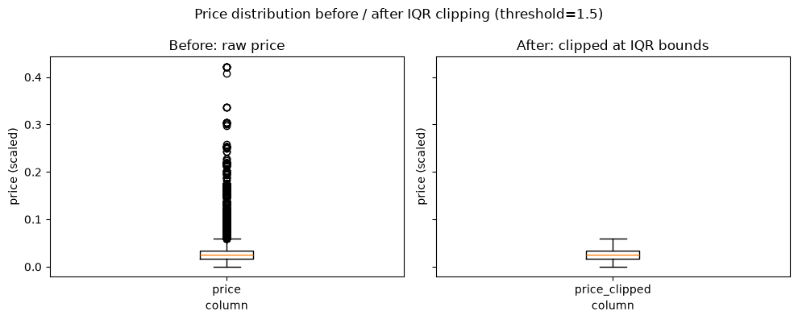
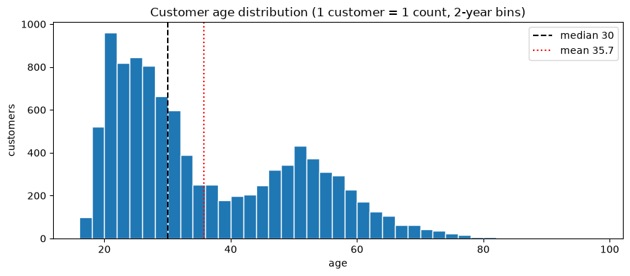
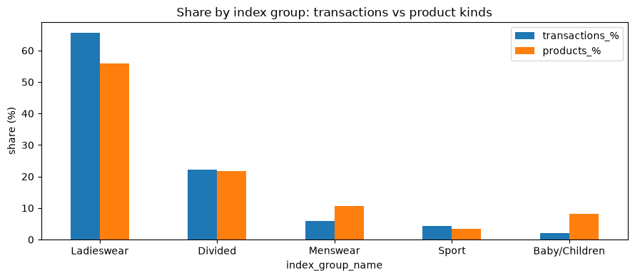
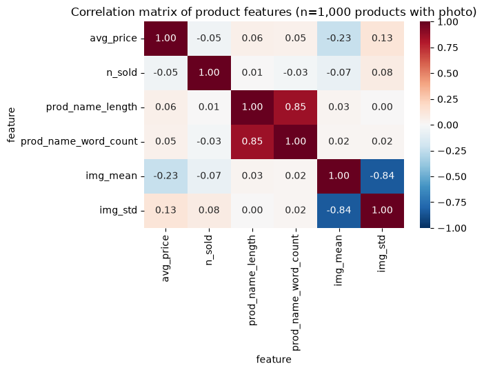
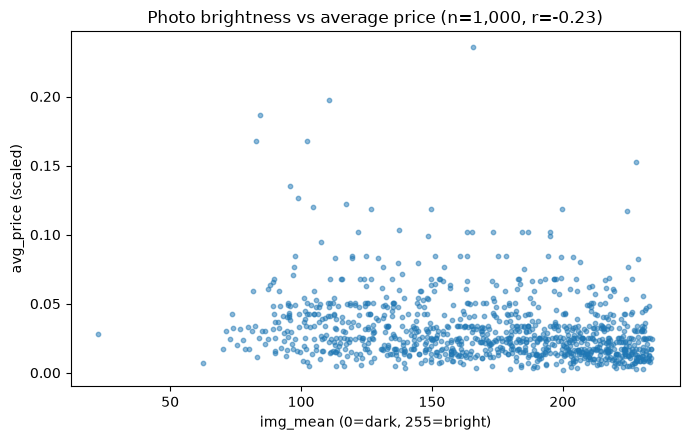
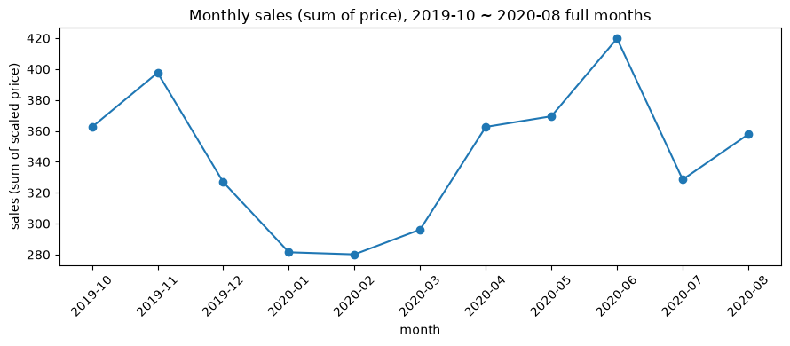
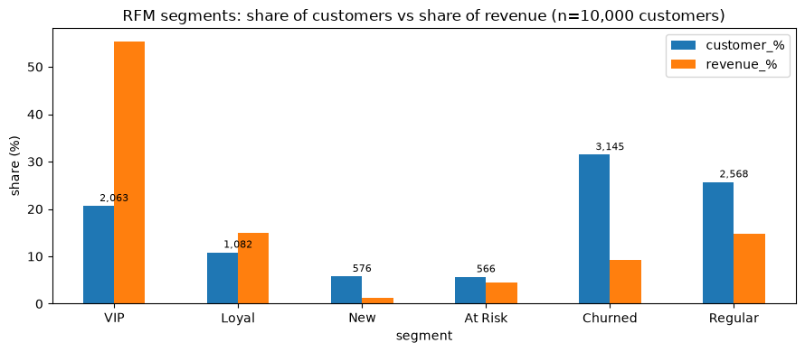
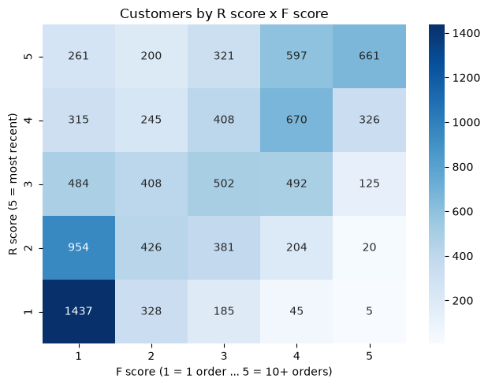

# A1-1 쇼핑몰 단골 찾기 — 분석 리포트

H&M Personalized Fashion Recommendations(Kaggle) 데이터로 멀티모달 EDA 와 RFM 고객 세분화를 한다.
분석 로직은 `src/pipeline.py` 의 `DataAnalyzer` 클래스에 있고, 이 노트북은 그 결과를 읽고 해석한다.

| 장 | 내용 | 과제 |
|---|---|---|
| 1 | 데이터 로드·기본 탐색 (`info`·`describe`·`head`) | §4-1 |
| 2 | 멀티모달 피처 — 상품명 텍스트, 상품 사진(NumPy 배열) | §4-3 |
| 3 | 결측치 그룹별 대치·IQR 이상치 처리 전후 박스플롯 | §4-4 |
| 4 | 단위별 기술통계·상관 분석, 히스토그램·막대·히트맵·산점도·라인 | §4-5·4-6 |
| 5 | RFM 점수·세그먼트·특징 표, README 인사이트 근거 | §4-7·4-8 |


```python
import sys
from pathlib import Path

# 노트북은 notebooks/ 에서 실행되므로 프로젝트 루트를 import 경로에 넣는다
ROOT = Path.cwd().parent if Path.cwd().name == "notebooks" else Path.cwd()
sys.path.insert(0, str(ROOT))

%load_ext autoreload
%autoreload 2

import matplotlib.pyplot as plt
import numpy as np
import pandas as pd
import seaborn as sns
from src.pipeline import DataAnalyzer, correlation_pairs, iqr_bounds, summary_stats

pd.set_option("display.max_columns", 30)
```

## 1. 데이터 로드 및 기본 탐색

### 표본 기준

| 항목 | 기준 |
|---|---|
| 기간 | 2019-09-23 ~ 2020-09-22 (최근 12개월) |
| 고객 | 기간 안에 1번 이상 산 고객 중 무작위 1만 명 (`random_state=42`) |
| 거래 | 뽑힌 고객의 기간 내 거래 줄 **전부** — 줄을 뽑으면 고객마다 F·M 이 줄어든다 |
| 결합 | 거래 줄마다 상품(`articles`)·고객(`customers`) 정보를 왼쪽 결합 |
| Recency 기준일 | 2020-09-22 (데이터 마지막 거래일) |


```python
analyzer = DataAnalyzer()
df = analyzer.load_data()
analyzer.load_summary
```


    {'start_date': '2019-09-23',
     'end_date': '2020-09-22',
     'random_state': 42,
     'rows_read': 31788324,
     'window_rows': 14898423,
     'window_customers': 994320,
     'sampled_customers': 10000,
     'rows': 149548,
     'articles_unmatched': 0,
     'customers_unmatched': 0,
     'seconds': 8.6}


```python
df.info()
```

    <class 'pandas.DataFrame'>
    RangeIndex: 149548 entries, 0 to 149547
    Data columns (total 23 columns):
     #   Column                        Non-Null Count   Dtype         
    ---  ------                        --------------   -----         
     0   t_dat                         149548 non-null  datetime64[us]
     1   customer_id                   149548 non-null  str           
     2   article_id                    149548 non-null  int64         
     3   price                         149548 non-null  float64       
     4   sales_channel_id              149548 non-null  int8          
     5   prod_name                     149548 non-null  str           
     6   product_type_name             149548 non-null  str           
     7   product_group_name            149548 non-null  str           
     8   graphical_appearance_name     149548 non-null  str           
     9   colour_group_name             149548 non-null  str           
     10  perceived_colour_value_name   149548 non-null  str           
     11  perceived_colour_master_name  149548 non-null  str           
     12  department_name               149548 non-null  str           
     13  index_name                    149548 non-null  str           
     14  index_group_name              149548 non-null  str           
     15  section_name                  149548 non-null  str           
     16  garment_group_name            149548 non-null  str           
     17  detail_desc                   149391 non-null  str           
     18  FN                            66055 non-null   float64       
     19  Active                        65426 non-null   float64       
     20  club_member_status            149269 non-null  str           
     21  fashion_news_frequency        148877 non-null  str           
     22  age                           149117 non-null  float64       
    dtypes: datetime64[us](1), float64(4), int64(1), int8(1), str(16)
    memory usage: 25.2 MB


**해석 — 구조와 결측**

- 149,548줄 × 23열로 과제 기준(1,000건·8열)을 넘는다. 날짜형(`t_dat`)·수치형(`price`·`age`)·범주형(`product_type_name` 등 11열)·텍스트(`prod_name`·`detail_desc`)가 있고, 이미지는 사진 확보 후 붙인다.
- 결측은 고객 정보에 몰려 있다: `FN` 83,493줄(55.8%)·`Active` 84,122줄(56.3%), `fashion_news_frequency` 671줄, `age` 431줄(0.3%), `club_member_status` 279줄, `detail_desc` 157줄.
- **시사점**: 절반 넘게 빈 열은 대치하기 전에 빈칸이 무슨 뜻인지부터 확인해야 한다.


```python
df.describe()
```


<div>
<style scoped>
    .dataframe tbody tr th:only-of-type {
        vertical-align: middle;
    }

    .dataframe tbody tr th {
        vertical-align: top;
    }

    .dataframe thead th {
        text-align: right;
    }
</style>
<table border="1" class="dataframe">
  <thead>
    <tr style="text-align: right;">
      <th></th>
      <th>t_dat</th>
      <th>article_id</th>
      <th>price</th>
      <th>sales_channel_id</th>
      <th>FN</th>
      <th>Active</th>
      <th>age</th>
    </tr>
  </thead>
  <tbody>
    <tr>
      <th>count</th>
      <td>149548</td>
      <td>1.495480e+05</td>
      <td>149548.000000</td>
      <td>149548.000000</td>
      <td>66055.0</td>
      <td>65426.0</td>
      <td>149117.000000</td>
    </tr>
    <tr>
      <th>mean</th>
      <td>2020-03-29 11:49:18.129831</td>
      <td>7.526006e+08</td>
      <td>0.028009</td>
      <td>1.714125</td>
      <td>1.0</td>
      <td>1.0</td>
      <td>35.532468</td>
    </tr>
    <tr>
      <th>min</th>
      <td>2019-09-23 00:00:00</td>
      <td>1.087750e+08</td>
      <td>0.000424</td>
      <td>1.000000</td>
      <td>1.0</td>
      <td>1.0</td>
      <td>17.000000</td>
    </tr>
    <tr>
      <th>25%</th>
      <td>2019-12-24 00:00:00</td>
      <td>7.060160e+08</td>
      <td>0.016542</td>
      <td>1.000000</td>
      <td>1.0</td>
      <td>1.0</td>
      <td>25.000000</td>
    </tr>
    <tr>
      <th>50%</th>
      <td>2020-04-09 00:00:00</td>
      <td>7.872255e+08</td>
      <td>0.025407</td>
      <td>2.000000</td>
      <td>1.0</td>
      <td>1.0</td>
      <td>31.000000</td>
    </tr>
    <tr>
      <th>75%</th>
      <td>2020-06-26 00:00:00</td>
      <td>8.362840e+08</td>
      <td>0.033881</td>
      <td>2.000000</td>
      <td>1.0</td>
      <td>1.0</td>
      <td>47.000000</td>
    </tr>
    <tr>
      <th>max</th>
      <td>2020-09-22 00:00:00</td>
      <td>9.534500e+08</td>
      <td>0.422034</td>
      <td>2.000000</td>
      <td>1.0</td>
      <td>1.0</td>
      <td>99.000000</td>
    </tr>
    <tr>
      <th>std</th>
      <td>NaN</td>
      <td>1.302270e+08</td>
      <td>0.019107</td>
      <td>0.451832</td>
      <td>0.0</td>
      <td>0.0</td>
      <td>13.358036</td>
    </tr>
  </tbody>
</table>
</div>


**해석 — 수치형 분포**

- `price` 는 평균 0.0280 > 중앙값 0.0254 이고, 최댓값 0.4220 이 Q3(0.0339)의 약 12배다 → 오른쪽 꼬리가 긴 분포.
- `age` 는 중앙값 31세, Q1 25 ~ Q3 47. 단 이 표는 **거래 줄 기준**이라 자주 사는 고객의 나이가 여러 번 세어진다.
- `FN`·`Active` 는 값이 있는 줄이 전부 1.0(std 0)이다.
- **시사점**: 금액도 소수에 쏠릴 수 있어 이상치 처리 전후 비교가 필요하고, 고객 특성은 고객 단위로 묶어 다시 봐야 한다.


```python
df.describe(include="str")
```


<div>
<style scoped>
    .dataframe tbody tr th:only-of-type {
        vertical-align: middle;
    }

    .dataframe tbody tr th {
        vertical-align: top;
    }

    .dataframe thead th {
        text-align: right;
    }
</style>
<table border="1" class="dataframe">
  <thead>
    <tr style="text-align: right;">
      <th></th>
      <th>customer_id</th>
      <th>prod_name</th>
      <th>product_type_name</th>
      <th>product_group_name</th>
      <th>graphical_appearance_name</th>
      <th>colour_group_name</th>
      <th>perceived_colour_value_name</th>
      <th>perceived_colour_master_name</th>
      <th>department_name</th>
      <th>index_name</th>
      <th>index_group_name</th>
      <th>section_name</th>
      <th>garment_group_name</th>
      <th>detail_desc</th>
      <th>club_member_status</th>
      <th>fashion_news_frequency</th>
    </tr>
  </thead>
  <tbody>
    <tr>
      <th>count</th>
      <td>149548</td>
      <td>149548</td>
      <td>149548</td>
      <td>149548</td>
      <td>149548</td>
      <td>149548</td>
      <td>149548</td>
      <td>149548</td>
      <td>149548</td>
      <td>149548</td>
      <td>149548</td>
      <td>149548</td>
      <td>149548</td>
      <td>149391</td>
      <td>149269</td>
      <td>148877</td>
    </tr>
    <tr>
      <th>unique</th>
      <td>10000</td>
      <td>14685</td>
      <td>110</td>
      <td>15</td>
      <td>29</td>
      <td>50</td>
      <td>8</td>
      <td>19</td>
      <td>230</td>
      <td>10</td>
      <td>5</td>
      <td>55</td>
      <td>21</td>
      <td>13737</td>
      <td>3</td>
      <td>2</td>
    </tr>
    <tr>
      <th>top</th>
      <td>92838b6470bf09ea2247a7f244a059e13eec4224cfe93d...</td>
      <td>Jade HW Skinny Denim TRS</td>
      <td>Trousers</td>
      <td>Garment Upper body</td>
      <td>Solid</td>
      <td>Black</td>
      <td>Dark</td>
      <td>Black</td>
      <td>Swimwear</td>
      <td>Ladieswear</td>
      <td>Ladieswear</td>
      <td>Womens Everyday Collection</td>
      <td>Jersey Fancy</td>
      <td>High-waisted jeans in washed superstretch deni...</td>
      <td>ACTIVE</td>
      <td>NONE</td>
    </tr>
    <tr>
      <th>freq</th>
      <td>462</td>
      <td>1089</td>
      <td>19771</td>
      <td>57944</td>
      <td>88522</td>
      <td>51990</td>
      <td>70672</td>
      <td>51874</td>
      <td>10747</td>
      <td>62482</td>
      <td>98193</td>
      <td>28172</td>
      <td>23342</td>
      <td>1155</td>
      <td>147015</td>
      <td>82504</td>
    </tr>
  </tbody>
</table>
</div>


**해석 — 범주형·식별자**

- `customer_id` 고유값 10,000 = 뽑은 고객 수. 고객당 평균 15.0줄인데 최다 고객은 462줄로 약 31배다.
- `index_group_name` 5개 중 Ladieswear 가 98,193줄(65.7%), `product_type_name` 110종 중 Trousers 가 19,771줄(13.2%)로 가장 많다.
- **시사점**: RFM 에서 극단적인 고객을 어떻게 다룰지 정해야 하고, 세그먼트 전략은 여성복 중심으로 해석된다.


```python
df.head()
```


<div>
<style scoped>
    .dataframe tbody tr th:only-of-type {
        vertical-align: middle;
    }

    .dataframe tbody tr th {
        vertical-align: top;
    }

    .dataframe thead th {
        text-align: right;
    }
</style>
<table border="1" class="dataframe">
  <thead>
    <tr style="text-align: right;">
      <th></th>
      <th>t_dat</th>
      <th>customer_id</th>
      <th>article_id</th>
      <th>price</th>
      <th>sales_channel_id</th>
      <th>prod_name</th>
      <th>product_type_name</th>
      <th>product_group_name</th>
      <th>graphical_appearance_name</th>
      <th>colour_group_name</th>
      <th>perceived_colour_value_name</th>
      <th>perceived_colour_master_name</th>
      <th>department_name</th>
      <th>index_name</th>
      <th>index_group_name</th>
      <th>section_name</th>
      <th>garment_group_name</th>
      <th>detail_desc</th>
      <th>FN</th>
      <th>Active</th>
      <th>club_member_status</th>
      <th>fashion_news_frequency</th>
      <th>age</th>
    </tr>
  </thead>
  <tbody>
    <tr>
      <th>0</th>
      <td>2019-09-23</td>
      <td>04e2301dc0581c5b443429e1614cf21ffe9b23d8d3fe05...</td>
      <td>740943002</td>
      <td>0.013542</td>
      <td>2</td>
      <td>Pamela</td>
      <td>Dress</td>
      <td>Garment Full body</td>
      <td>Stripe</td>
      <td>Off White</td>
      <td>Dusty Light</td>
      <td>White</td>
      <td>Dress</td>
      <td>Ladieswear</td>
      <td>Ladieswear</td>
      <td>Womens Everyday Collection</td>
      <td>Dresses Ladies</td>
      <td>Short dress in a viscose weave with a gentle V...</td>
      <td>1.0</td>
      <td>1.0</td>
      <td>ACTIVE</td>
      <td>Regularly</td>
      <td>34.0</td>
    </tr>
    <tr>
      <th>1</th>
      <td>2019-09-23</td>
      <td>04e2301dc0581c5b443429e1614cf21ffe9b23d8d3fe05...</td>
      <td>660497001</td>
      <td>0.018627</td>
      <td>2</td>
      <td>Emery(1)</td>
      <td>Dress</td>
      <td>Garment Full body</td>
      <td>Solid</td>
      <td>Black</td>
      <td>Dark</td>
      <td>Black</td>
      <td>Jersey fancy</td>
      <td>Ladieswear</td>
      <td>Ladieswear</td>
      <td>Womens Everyday Collection</td>
      <td>Jersey Fancy</td>
      <td>Short sleeveless dress in soft slub jersey mad...</td>
      <td>1.0</td>
      <td>1.0</td>
      <td>ACTIVE</td>
      <td>Regularly</td>
      <td>34.0</td>
    </tr>
    <tr>
      <th>2</th>
      <td>2019-09-23</td>
      <td>04e2301dc0581c5b443429e1614cf21ffe9b23d8d3fe05...</td>
      <td>727611003</td>
      <td>0.025407</td>
      <td>2</td>
      <td>Zidane jumpsuit</td>
      <td>Jumpsuit/Playsuit</td>
      <td>Garment Full body</td>
      <td>All over pattern</td>
      <td>Yellow</td>
      <td>Medium</td>
      <td>Yellow</td>
      <td>Dresses</td>
      <td>Divided</td>
      <td>Divided</td>
      <td>Divided Collection</td>
      <td>Dresses Ladies</td>
      <td>V-neck playsuit in a crinkled weave with a wra...</td>
      <td>1.0</td>
      <td>1.0</td>
      <td>ACTIVE</td>
      <td>Regularly</td>
      <td>34.0</td>
    </tr>
    <tr>
      <th>3</th>
      <td>2019-09-23</td>
      <td>04e2301dc0581c5b443429e1614cf21ffe9b23d8d3fe05...</td>
      <td>727611003</td>
      <td>0.025407</td>
      <td>2</td>
      <td>Zidane jumpsuit</td>
      <td>Jumpsuit/Playsuit</td>
      <td>Garment Full body</td>
      <td>All over pattern</td>
      <td>Yellow</td>
      <td>Medium</td>
      <td>Yellow</td>
      <td>Dresses</td>
      <td>Divided</td>
      <td>Divided</td>
      <td>Divided Collection</td>
      <td>Dresses Ladies</td>
      <td>V-neck playsuit in a crinkled weave with a wra...</td>
      <td>1.0</td>
      <td>1.0</td>
      <td>ACTIVE</td>
      <td>Regularly</td>
      <td>34.0</td>
    </tr>
    <tr>
      <th>4</th>
      <td>2019-09-23</td>
      <td>04e2301dc0581c5b443429e1614cf21ffe9b23d8d3fe05...</td>
      <td>740943001</td>
      <td>0.013542</td>
      <td>2</td>
      <td>Pamela</td>
      <td>Dress</td>
      <td>Garment Full body</td>
      <td>All over pattern</td>
      <td>Dark Orange</td>
      <td>Dark</td>
      <td>Beige</td>
      <td>Dress</td>
      <td>Ladieswear</td>
      <td>Ladieswear</td>
      <td>Womens Everyday Collection</td>
      <td>Dresses Ladies</td>
      <td>Short dress in a viscose weave with a gentle V...</td>
      <td>1.0</td>
      <td>1.0</td>
      <td>ACTIVE</td>
      <td>Regularly</td>
      <td>34.0</td>
    </tr>
  </tbody>
</table>
</div>


**해석 — 실제 줄 모양**

- 인덱스 2·3 은 같은 고객·같은 날·같은 상품(`727611003`)·같은 가격이다. Kaggle 데이터 설명대로 **같은 상품을 2개 산 것**을 뜻하는 중복 줄이다(이 데이터에는 수량 열이 없다).
- 다섯 줄 모두 같은 고객·같은 날이라, 주문 정의(고객 + 날짜)로는 주문 1건이다.
- **시사점**: 중복 줄을 지우면 M(금액)이 줄어들므로 지우지 않는다.

## 2. 멀티모달 피처 엔지니어링

### 2-1. 텍스트 — 상품명 단어 수·글자 수

`add_text_features()` 가 `prod_name` 에서 `prod_name_word_count`(공백 기준 단어 수)와 `prod_name_length`(글자 수)를 만든다. `.str` 접근자로 열 전체를 한 번에 계산한다.


```python
analyzer.add_text_features()
df[["prod_name", "prod_name_word_count", "prod_name_length"]].head()
```


<div>
<style scoped>
    .dataframe tbody tr th:only-of-type {
        vertical-align: middle;
    }

    .dataframe tbody tr th {
        vertical-align: top;
    }

    .dataframe thead th {
        text-align: right;
    }
</style>
<table border="1" class="dataframe">
  <thead>
    <tr style="text-align: right;">
      <th></th>
      <th>prod_name</th>
      <th>prod_name_word_count</th>
      <th>prod_name_length</th>
    </tr>
  </thead>
  <tbody>
    <tr>
      <th>0</th>
      <td>Pamela</td>
      <td>1</td>
      <td>6</td>
    </tr>
    <tr>
      <th>1</th>
      <td>Emery(1)</td>
      <td>1</td>
      <td>8</td>
    </tr>
    <tr>
      <th>2</th>
      <td>Zidane jumpsuit</td>
      <td>2</td>
      <td>15</td>
    </tr>
    <tr>
      <th>3</th>
      <td>Zidane jumpsuit</td>
      <td>2</td>
      <td>15</td>
    </tr>
    <tr>
      <th>4</th>
      <td>Pamela</td>
      <td>1</td>
      <td>6</td>
    </tr>
  </tbody>
</table>
</div>


```python
# 상품명은 상품의 속성이므로 상품 1개당 1번만 세어 분포를 본다 (거래 줄 기준이면 많이 팔린 상품이 여러 번 세어짐)
products = df.drop_duplicates("article_id")
print("고유 상품 수:", len(products))
products[["prod_name_word_count", "prod_name_length"]].describe()
```

    고유 상품 수: 27783


<div>
<style scoped>
    .dataframe tbody tr th:only-of-type {
        vertical-align: middle;
    }

    .dataframe tbody tr th {
        vertical-align: top;
    }

    .dataframe thead th {
        text-align: right;
    }
</style>
<table border="1" class="dataframe">
  <thead>
    <tr style="text-align: right;">
      <th></th>
      <th>prod_name_word_count</th>
      <th>prod_name_length</th>
    </tr>
  </thead>
  <tbody>
    <tr>
      <th>count</th>
      <td>27783.000000</td>
      <td>27783.000000</td>
    </tr>
    <tr>
      <th>mean</th>
      <td>2.794947</td>
      <td>15.776122</td>
    </tr>
    <tr>
      <th>std</th>
      <td>1.041518</td>
      <td>5.808003</td>
    </tr>
    <tr>
      <th>min</th>
      <td>1.000000</td>
      <td>1.000000</td>
    </tr>
    <tr>
      <th>25%</th>
      <td>2.000000</td>
      <td>12.000000</td>
    </tr>
    <tr>
      <th>50%</th>
      <td>3.000000</td>
      <td>15.000000</td>
    </tr>
    <tr>
      <th>75%</th>
      <td>3.000000</td>
      <td>20.000000</td>
    </tr>
    <tr>
      <th>max</th>
      <td>7.000000</td>
      <td>30.000000</td>
    </tr>
  </tbody>
</table>
</div>


```python
products["prod_name_word_count"].value_counts().sort_index()
```


    prod_name_word_count
    1    2351
    2    9366
    3    9546
    4    4890
    5    1419
    6     201
    7      10
    Name: count, dtype: int64


**해석 — 상품명 피처**

- 표본에 나온 고유 상품 27,783개 기준 단어 수 중앙값 3(평균 2.79), 2~3단어가 18,912개(68.1%)다. 글자 수는 중앙값 15·평균 15.8·최대 30.
- 원본 `articles.csv` 전체에서 31자 이상인 이름은 0개이고 정확히 30자가 0.7%다 → 이름이 **30자에서 잘려 저장**돼 있다(예: `FIFTY SHADES moulded halternec`). 글자 수 피처는 30이 상한인 값이다.
- `F`·`s`·`MY` 처럼 1~2글자 이름도 있다(축약·코드형 이름).
- **시사점**: 글자 수를 다른 변수와 상관 분석할 때는 30자 상한 때문에 긴 이름 쪽 차이가 눌려 있다는 점을 감안해야 한다.

### 2-2. 이미지 — 사진 픽셀 평균·표준편차

**사진 준비**: 전체 zip(34.56GB)에서 표본 고객이 산 상품 중 사진이 있는 것만 후보로 두고 1,000장을 뽑아 `data/images/` 에 풀었다(`python -m src.extract_images`, `random_state=42`).

**`add_image_features(step=10)` 처리 순서**
1. `imread()` 로 읽은 배열을 슬라이싱 `arr[::10, ::10]` 으로 다운샘플 (1750×1166 → 175×117)
2. 크기가 다른 사진(15장, 폭 622~3370)이 있어 가장 작은 크기 175×63 에 맞춰 **가운데를 잘라** `(1000, 175, 63, 3)` 4차원 배열 하나로 쌓는다
3. `mean(axis=(1, 2, 3))`·`std(axis=(1, 2, 3))` 로 사진 1,000장의 평균·표준편차를 **반복문 없이 한 번에** 계산

가운데만 남기므로 양옆 배경이 빠지고 상품 부분의 밝기·대비를 더 반영한다.


```python
analyzer.add_image_features(step=10)
analyzer.image_summary
```


    {'images': 1000,
     'step': 10,
     'stack_shape': (1000, 175, 63, 3),
     'products_with_image': '1,000 / 27,783',
     'rows_with_image': '5,282 / 149,548',
     'read_seconds': 4.9,
     'compute_seconds': 0.1}


```python
img_products = df.drop_duplicates("article_id").dropna(subset=["img_mean"])
img_products[["img_mean", "img_std"]].describe()
```


<div>
<style scoped>
    .dataframe tbody tr th:only-of-type {
        vertical-align: middle;
    }

    .dataframe tbody tr th {
        vertical-align: top;
    }

    .dataframe thead th {
        text-align: right;
    }
</style>
<table border="1" class="dataframe">
  <thead>
    <tr style="text-align: right;">
      <th></th>
      <th>img_mean</th>
      <th>img_std</th>
    </tr>
  </thead>
  <tbody>
    <tr>
      <th>count</th>
      <td>1000.000000</td>
      <td>1000.000000</td>
    </tr>
    <tr>
      <th>mean</th>
      <td>170.094642</td>
      <td>61.598607</td>
    </tr>
    <tr>
      <th>std</th>
      <td>43.382597</td>
      <td>29.307091</td>
    </tr>
    <tr>
      <th>min</th>
      <td>22.533847</td>
      <td>3.709793</td>
    </tr>
    <tr>
      <th>25%</th>
      <td>135.368284</td>
      <td>35.605939</td>
    </tr>
    <tr>
      <th>50%</th>
      <td>176.517128</td>
      <td>67.814605</td>
    </tr>
    <tr>
      <th>75%</th>
      <td>208.342366</td>
      <td>88.209996</td>
    </tr>
    <tr>
      <th>max</th>
      <td>234.216085</td>
      <td>115.836700</td>
    </tr>
  </tbody>
</table>
</div>


```python
# 검증: H&M 이 붙인 색 밝기 분류와 img_mean 이 같은 방향인가
(img_products.groupby("perceived_colour_value_name")["img_mean"]
 .agg(["count", "median"]).sort_values("median"))
```


<div>
<style scoped>
    .dataframe tbody tr th:only-of-type {
        vertical-align: middle;
    }

    .dataframe tbody tr th {
        vertical-align: top;
    }

    .dataframe thead th {
        text-align: right;
    }
</style>
<table border="1" class="dataframe">
  <thead>
    <tr style="text-align: right;">
      <th></th>
      <th>count</th>
      <th>median</th>
    </tr>
    <tr>
      <th>perceived_colour_value_name</th>
      <th></th>
      <th></th>
    </tr>
  </thead>
  <tbody>
    <tr>
      <th>Undefined</th>
      <td>1</td>
      <td>90.082993</td>
    </tr>
    <tr>
      <th>Dark</th>
      <td>424</td>
      <td>132.704339</td>
    </tr>
    <tr>
      <th>Medium Dusty</th>
      <td>128</td>
      <td>174.554815</td>
    </tr>
    <tr>
      <th>Medium</th>
      <td>48</td>
      <td>184.958035</td>
    </tr>
    <tr>
      <th>Dusty Light</th>
      <td>207</td>
      <td>203.834225</td>
    </tr>
    <tr>
      <th>Bright</th>
      <td>52</td>
      <td>207.874044</td>
    </tr>
    <tr>
      <th>Light</th>
      <td>140</td>
      <td>223.107770</td>
    </tr>
  </tbody>
</table>
</div>


```python
print("img_mean ↔ img_std 상관계수:", round(img_products["img_mean"].corr(img_products["img_std"]), 3))
```

    img_mean ↔ img_std 상관계수: -0.84


**해석 — 이미지 피처**

- 사진 1,000장은 표본 상품 27,783개의 3.6%, 거래 줄로는 5,282줄(3.5%)이다. 나머지 NaN 은 사진을 뽑지 않아 생긴 빈칸이라 결측 대치 대상이 아니고, 이미지 피처 분석은 **상품 1,000개 단위**로 한다.
- `img_mean`(0~255) 중앙값 176.5·평균 170.1 로 밝은 쪽이다 — 대부분 밝은 회색 배경에서 찍은 사진이다.
- **검증**: H&M 의 색 밝기 분류와 같은 방향이다. `img_mean` 중앙값 Dark 132.7 → Medium 185.0 → Light 223.1.
- `img_std` 는 대비다. 어두운 옷을 밝은 배경에 찍으면 크고(예: 검은 상의 mean 115·std 97), 흰 옷은 배경과 비슷해 작다(예: 흰 속옷 mean 234·std 5). 그래서 두 열의 상관계수가 **−0.84** 다.
- **시사점**: `img_mean` 은 상품 색의 밝기, `img_std` 는 배경 대비를 나타내지만 둘이 강하게 겹친다(−0.84). 다른 변수와의 관계를 볼 때 두 열을 독립된 정보로 세지 않아야 한다.

#### 반복문 vs 벡터 연산

같은 '사진별 픽셀 평균'을 세 가지 방법으로 계산해 시간을 잰다. 픽셀마다 도는 순수 반복문은 느려서 20장만 재고 1,000장으로 환산한다.


```python
import time

stack = analyzer.image_stack
print(f"stack: shape={stack.shape}, dtype={stack.dtype}, {stack.nbytes / 1e6:.1f} MB, "
      f"C 연속 배치={stack.flags['C_CONTIGUOUS']}")
print(f"add_image_features: 파일 읽기·다운샘플 {analyzer.image_summary['read_seconds']}초 / "
      f"평균·표준편차 계산 {analyzer.image_summary['compute_seconds']}초")

def python_loop_mean(img):
    total = 0
    for value in img.ravel().tolist():  # 픽셀 값을 하나씩 꺼내 더한다
        total += value
    return total / img.size

def best_of(fn, repeat=3):
    best, result = float("inf"), None
    for _ in range(repeat):
        t = time.perf_counter()
        result = fn()
        best = min(best, time.perf_counter() - t)
    return best, result

n_loop = 20
t_loop, r_loop = best_of(lambda: [python_loop_mean(img) for img in stack[:n_loop]], repeat=1)
t_each, r_each = best_of(lambda: np.array([img.mean() for img in stack]))
t_vec, r_vec = best_of(lambda: stack.mean(axis=(1, 2, 3)))
assert np.allclose(r_loop, r_vec[:n_loop]) and np.allclose(r_each, r_vec)  # 세 방법의 결과가 같다

bench = pd.DataFrame({"seconds_for_1000_images": [t_loop * len(stack) / n_loop, t_each, t_vec]},
                     index=["for loop over pixels (Python)", "for loop over images + img.mean()",
                            "stack.mean(axis=(1, 2, 3))"])
bench["times_slower_than_vectorized"] = bench["seconds_for_1000_images"] / t_vec
bench.round(4)
```

    stack: shape=(1000, 175, 63, 3), dtype=uint8, 33.1 MB, C 연속 배치=True
    add_image_features: 파일 읽기·다운샘플 4.9초 / 평균·표준편차 계산 0.1초


<div>
<style scoped>
    .dataframe tbody tr th:only-of-type {
        vertical-align: middle;
    }

    .dataframe tbody tr th {
        vertical-align: top;
    }

    .dataframe thead th {
        text-align: right;
    }
</style>
<table border="1" class="dataframe">
  <thead>
    <tr style="text-align: right;">
      <th></th>
      <th>seconds_for_1000_images</th>
      <th>times_slower_than_vectorized</th>
    </tr>
  </thead>
  <tbody>
    <tr>
      <th>for loop over pixels (Python)</th>
      <td>0.3597</td>
      <td>31.0694</td>
    </tr>
    <tr>
      <th>for loop over images + img.mean()</th>
      <td>0.0129</td>
      <td>1.1113</td>
    </tr>
    <tr>
      <th>stack.mean(axis=(1, 2, 3))</th>
      <td>0.0116</td>
      <td>1.0000</td>
    </tr>
  </tbody>
</table>
</div>


**해석 — 반복문 vs 벡터 연산**

- `stack` 은 `uint8` 값 3,307만 개(33.1MB)가 메모리에 한 줄로 이어 붙은(C 연속) 배열이다.
- 픽셀마다 도는 파이썬 반복문은 1,000장 환산 약 0.36초로, `stack.mean(axis=(1, 2, 3))`(약 0.012초)보다 약 31배 느리다. 사진마다 도는 반복문 안에서 `img.mean()` 을 부르면 약 0.013초로 약 1.1배밖에 차이 나지 않는다.
- 시간은 실행할 때마다 조금씩 달라서 반올림한 값으로 적는다.
- 이유: 파이썬 반복문은 값 하나마다 파이썬 객체를 꺼내 덧셈을 해석한다. NumPy 는 같은 자료형이 일정한 간격으로 이어진 메모리를 C 로 짠 반복 한 번으로 훑는다(CPU 캐시와 SIMD 명령을 쓸 수 있는 구조). 사진 단위 반복이 거의 느리지 않은 것은 파이썬이 도는 횟수가 3,307만 번에서 1,000번으로 줄었기 때문이다.
- **시사점**: 반복문을 없애야 하는 곳은 값마다 도는 가장 안쪽 반복이다. 이 파이프라인에 남은 병목은 계산(약 0.1초)이 아니라 사진 파일 읽기(약 4.9초, 약 98%)다.

## 3. 결측치·이상치 처리

### 3-1. 결측치 — 규칙 3가지

| 대상 | 규칙 | 이유 |
|---|---|---|
| `FN`·`Active` | 빈칸 → 0 | 값이 1 하나뿐 → '해당하면 1, 아니면 비움'으로 저장된 표시 열. 대치가 아니라 인코딩 복원 |
| `club_member_status`·`fashion_news_frequency`·`detail_desc` | 빈칸 → `"UNKNOWN"` | 범주·텍스트 열. 앞의 두 열은 `age` 대치의 그룹 기준이라 먼저 채운다 |
| `age` | 고객 그룹(`club_member_status` × `fashion_news_frequency`) 중앙값 | **GroupBy 대치**. 거래 줄이 아니라 고객 1명 = 1표로 계산 |


```python
analyzer.handle_missing_values()
analyzer.missing_report
```


<div>
<style scoped>
    .dataframe tbody tr th:only-of-type {
        vertical-align: middle;
    }

    .dataframe tbody tr th {
        vertical-align: top;
    }

    .dataframe thead th {
        text-align: right;
    }
</style>
<table border="1" class="dataframe">
  <thead>
    <tr style="text-align: right;">
      <th></th>
      <th>before</th>
      <th>after</th>
    </tr>
  </thead>
  <tbody>
    <tr>
      <th>FN</th>
      <td>83493</td>
      <td>0</td>
    </tr>
    <tr>
      <th>Active</th>
      <td>84122</td>
      <td>0</td>
    </tr>
    <tr>
      <th>club_member_status</th>
      <td>279</td>
      <td>0</td>
    </tr>
    <tr>
      <th>fashion_news_frequency</th>
      <td>671</td>
      <td>0</td>
    </tr>
    <tr>
      <th>detail_desc</th>
      <td>157</td>
      <td>0</td>
    </tr>
    <tr>
      <th>age</th>
      <td>431</td>
      <td>0</td>
    </tr>
  </tbody>
</table>
</div>


```python
# age 대치에 쓴 그룹별 중앙값 (고객 1명 = 1표)
analyzer.missing_report.attrs["group_stat"]
```


    club_member_status  fashion_news_frequency
    ACTIVE              NONE                      30.0
                        Regularly                 31.0
                        UNKNOWN                   39.5
    LEFT CLUB           NONE                      20.0
    PRE-CREATE          NONE                      36.0
                        Regularly                 49.0
                        UNKNOWN                   53.0
    UNKNOWN             NONE                      24.0
                        Regularly                 24.5
                        UNKNOWN                    NaN
    Name: _fill, dtype: float64


**해석 — 결측 처리**

- 처리 후 6개 열의 결측이 모두 0이다.
- `age` 결측 431줄은 고객 77명이다. 대부분 큰 그룹에서 채워졌다: ACTIVE·NONE(나이 있는 고객 5,825명, 중앙값 30세), PRE-CREATE·NONE(321명, 36세). 같은 NONE 이어도 PRE-CREATE 가 ACTIVE 보다 6세 높아, 전체 중앙값 하나로 채우는 것보다 고객 특성이 반영된다.
- 세 속성이 모두 빈 고객 20명(UNKNOWN·UNKNOWN)은 그룹에 나이 값이 하나도 없어 전체 중앙값 30세로 채웠다.
- **시사점**: 대치된 고객은 표본의 0.8%(77/10,000)라 나이 분포에 주는 영향은 작다. 다만 PRE-CREATE·UNKNOWN(19명) 같은 소수 그룹의 중앙값은 불안정하다.

#### 그룹 대치가 분포에 주는 영향

나이를 아는 고객 20% 의 나이를 일부러 지우고, 그룹 중앙값과 전체 중앙값으로 각각 채워 실제 값과 비교한다(고객 1명 = 1줄). MAE(Mean Absolute Error, 평균 절대 오차)는 채운 값이 실제 나이에서 평균 몇 살 벗어나는지다.


```python
group_cols = ["club_member_status", "fashion_news_frequency"]
customers_age = df.drop_duplicates("customer_id").set_index("customer_id")
imputed_ids = df.loc[analyzer.imputed_rows, "customer_id"].unique()
known = customers_age.drop(imputed_ids)  # 원래 나이가 있던 고객만
print(f"실제 대치: 고객 {len(imputed_ids)}명({len(imputed_ids) / len(customers_age):.2%}) — "
      f"나이 표준편차 {known['age'].std():.3f} → 대치 후 {customers_age['age'].std():.3f}")

hidden = known.sample(frac=0.2, random_state=42)
rest = known.drop(hidden.index)
group_fill = (hidden[group_cols]
              .join(rest.groupby(group_cols)["age"].median().rename("fill"), on=group_cols)["fill"]
              .fillna(rest["age"].median()))
overall_fill = pd.Series(rest["age"].median(), index=hidden.index)
print(f"시뮬레이션: 지운 고객 {len(hidden):,}명, 실제 나이 표준편차 {hidden['age'].std():.2f}")
pd.DataFrame({
    "MAE_years": [(group_fill - hidden["age"]).abs().mean(), (overall_fill - hidden["age"]).abs().mean()],
    "filled_std": [group_fill.std(), overall_fill.std()],
    "filled_unique_values": [group_fill.nunique(), overall_fill.nunique()],
}, index=["group median", "overall median"]).round(2)
```

    실제 대치: 고객 77명(0.77%) — 나이 표준편차 14.460 → 대치 후 14.412
    시뮬레이션: 지운 고객 1,985명, 실제 나이 표준편차 14.65


<div>
<style scoped>
    .dataframe tbody tr th:only-of-type {
        vertical-align: middle;
    }

    .dataframe tbody tr th {
        vertical-align: top;
    }

    .dataframe thead th {
        text-align: right;
    }
</style>
<table border="1" class="dataframe">
  <thead>
    <tr style="text-align: right;">
      <th></th>
      <th>MAE_years</th>
      <th>filled_std</th>
      <th>filled_unique_values</th>
    </tr>
  </thead>
  <tbody>
    <tr>
      <th>group median</th>
      <td>12.00</td>
      <td>1.92</td>
      <td>7</td>
    </tr>
    <tr>
      <th>overall median</th>
      <td>12.06</td>
      <td>0.00</td>
      <td>1</td>
    </tr>
  </tbody>
</table>
</div>


**해석 — 그룹 대치의 영향**

- 실제로 대치한 고객은 77명(0.77%)뿐이라 나이 표준편차는 14.460 에서 14.412 로 0.3% 줄었다.
- 시뮬레이션(나이를 아는 고객 1,985명의 나이를 지움)에서 그룹 중앙값으로 채운 값은 7가지뿐이고 표준편차가 1.92 다. 실제 나이의 표준편차는 14.65 다. 채운 고객들이 그룹마다 한 값에 몰려 **분산이 실제보다 크게 줄어든다**.
- 정확도는 거의 나아지지 않는다(MAE 그룹 중앙값 12.00살, 전체 중앙값 12.06살). 회원 상태·뉴스 수신 빈도가 나이를 잘 가르지 못하고, 나이 분포는 봉우리가 두 개(4-2)라 어떤 한 값으로 채워도 한쪽 봉우리와는 멀다.
- 그룹 간 차이도 부풀릴 수 있다. 채운 고객끼리 비교하면 그룹 차이가 중앙값 차이(예: LEFT CLUB 20세 vs PRE-CREATE·UNKNOWN 53세) 그대로 나타난다.
- **시사점**: 결측이 0.77% 라 이번 결과에는 영향이 작다. 하지만 결측 비중이 커지면 그룹 대치는 분산을 줄이고 그룹 차이를 과장한다. 나이를 쓰는 분석은 대치한 고객을 표시해 두거나 빼고 다시 확인하는 것이 안전하다.

### 3-2. 이상치 — IQR(Interquartile Range, 사분위 범위)

`price` 에 IQR 경계를 적용해 경계 밖 값을 찾는다. 비싼 상품은 입력 오류가 아니라 실제 구매라 지우지 않고, 원본은 그대로 둔 채 경계값으로 자른 `price_clipped` 열을 만든다. RFM 의 M 은 원본 `price` 로 계산한다.


```python
outliers = analyzer.detect_outliers("price", threshold=1.5)
lower, upper = analyzer.outlier_bounds["price"]
print(f"경계: {lower:.4f} ~ {upper:.4f}")
print(f"이상치 줄: {len(outliers):,} / {len(df):,} ({len(outliers) / len(df):.1%})")
print(f"아래쪽: {(df['price'] < lower).sum():,}  위쪽: {(df['price'] > upper).sum():,}")
```

    경계: -0.0095 ~ 0.0599
    이상치 줄: 7,331 / 149,548 (4.9%)
    아래쪽: 0  위쪽: 7,331


```python
analyzer.clip_outliers("price", threshold=1.5)
df[["price", "price_clipped"]].describe()
```


<div>
<style scoped>
    .dataframe tbody tr th:only-of-type {
        vertical-align: middle;
    }

    .dataframe tbody tr th {
        vertical-align: top;
    }

    .dataframe thead th {
        text-align: right;
    }
</style>
<table border="1" class="dataframe">
  <thead>
    <tr style="text-align: right;">
      <th></th>
      <th>price</th>
      <th>price_clipped</th>
    </tr>
  </thead>
  <tbody>
    <tr>
      <th>count</th>
      <td>149548.000000</td>
      <td>149548.000000</td>
    </tr>
    <tr>
      <th>mean</th>
      <td>0.028009</td>
      <td>0.026824</td>
    </tr>
    <tr>
      <th>std</th>
      <td>0.019107</td>
      <td>0.014458</td>
    </tr>
    <tr>
      <th>min</th>
      <td>0.000424</td>
      <td>0.000424</td>
    </tr>
    <tr>
      <th>25%</th>
      <td>0.016542</td>
      <td>0.016542</td>
    </tr>
    <tr>
      <th>50%</th>
      <td>0.025407</td>
      <td>0.025407</td>
    </tr>
    <tr>
      <th>75%</th>
      <td>0.033881</td>
      <td>0.033881</td>
    </tr>
    <tr>
      <th>max</th>
      <td>0.422034</td>
      <td>0.059890</td>
    </tr>
  </tbody>
</table>
</div>


```python
fig, axes = plt.subplots(1, 2, figsize=(10, 4), sharey=True)
axes[0].boxplot(df["price"], tick_labels=["price"])
axes[0].set_title("Before: raw price")
axes[1].boxplot(df["price_clipped"], tick_labels=["price_clipped"])
axes[1].set_title("After: clipped at IQR bounds")
for ax in axes:
    ax.set_xlabel("column")
    ax.set_ylabel("price (scaled)")
fig.suptitle("Price distribution before / after IQR clipping (threshold=1.5)")
plt.tight_layout()
plt.show()
```


    

    


**해석 — IQR 이상치**

- 경계는 -0.0095 ~ 0.0599 다. 가격에는 음수가 없어 아래쪽 이상치는 0줄이고, 이상치 7,331줄(4.9%)이 **전부 위쪽**이다 → 오른쪽 꼬리.
- 경계값으로 자른 뒤 최댓값 0.4220 → 0.0599, 표준편차 0.0191 → 0.0145(−24%), 평균 0.0280 → 0.0268(−4%). 25%·50%·75% 값은 그대로다 — IQR 방식은 가운데 50% 를 건드리지 않고 꼬리만 누른다.
- **시사점**: 4.9% 의 비싼 구매가 표준편차를 24% 부풀리고 있었다. 평균·표준편차로 가격을 요약하면 이 꼬리에 끌려가므로 중앙값·사분위수를 함께 보고, 실제 구매인 만큼 RFM 의 M 은 원본 `price` 로 계산한다.

#### IQR 을 쓰는 이유와 비대칭 분포에서의 한계

같은 `price` 열에 세 가지 경계를 적용해 몇 줄을 이상치로 잡는지 비교한다. 평균 ± 3 표준편차는 정규분포를 가정한 흔한 방법이고, log 변환 뒤 IQR 은 오른쪽 꼬리를 줄인 뒤 같은 규칙을 쓰는 방법이다.


```python
price = df["price"]
mu, sigma = price.mean(), price.std()
log_lower, log_upper = iqr_bounds(np.log(price))  # price 는 전부 0 보다 커서 log 를 쓸 수 있다
compare = pd.DataFrame({
    "lower": [lower, mu - 3 * sigma, np.exp(log_lower)],
    "upper": [upper, mu + 3 * sigma, np.exp(log_upper)],
}, index=["IQR x1.5", "mean +/- 3 std", "IQR x1.5 on log(price)"])
compare["below"] = [(price < v).sum() for v in compare["lower"]]
compare["above"] = [(price > v).sum() for v in compare["upper"]]
compare["flagged_%"] = (compare["below"] + compare["above"]) / len(price) * 100
print(f"왜도(skewness, 0 이면 좌우 대칭, 양수면 오른쪽 꼬리): {price.skew():.2f}")
print(f"표준편차: 전체 {sigma:.4f} / IQR 경계 안의 줄만 {price[price.between(lower, upper)].std():.4f}")
compare.round(4)
```

    왜도(skewness, 0 이면 좌우 대칭, 양수면 오른쪽 꼬리): 3.31
    표준편차: 전체 0.0191 / IQR 경계 안의 줄만 0.0127


<div>
<style scoped>
    .dataframe tbody tr th:only-of-type {
        vertical-align: middle;
    }

    .dataframe tbody tr th {
        vertical-align: top;
    }

    .dataframe thead th {
        text-align: right;
    }
</style>
<table border="1" class="dataframe">
  <thead>
    <tr style="text-align: right;">
      <th></th>
      <th>lower</th>
      <th>upper</th>
      <th>below</th>
      <th>above</th>
      <th>flagged_%</th>
    </tr>
  </thead>
  <tbody>
    <tr>
      <th>IQR x1.5</th>
      <td>-0.0095</td>
      <td>0.0599</td>
      <td>0</td>
      <td>7331</td>
      <td>4.9021</td>
    </tr>
    <tr>
      <th>mean +/- 3 std</th>
      <td>-0.0293</td>
      <td>0.0853</td>
      <td>0</td>
      <td>1691</td>
      <td>1.1307</td>
    </tr>
    <tr>
      <th>IQR x1.5 on log(price)</th>
      <td>0.0056</td>
      <td>0.0993</td>
      <td>3574</td>
      <td>1465</td>
      <td>3.3695</td>
    </tr>
  </tbody>
</table>
</div>


**해석 — IQR 을 쓰는 이유와 한계**

- `price` 는 왜도 3.31 로 오른쪽 꼬리가 길다.
- 평균 ± 3 표준편차는 1,691줄(1.1%)만 잡는다. 표준편차가 꼬리 때문에 부풀어 있기 때문이다(전체 0.0191, IQR 경계 안의 줄만 0.0127). 이상치가 경계를 넓혀 스스로를 숨기는 셈이다. IQR 은 사분위수로 경계를 정하므로 꼬리가 아무리 길어도 경계가 움직이지 않는다(0.0599).
- 비대칭 분포에서의 한계: 아래 경계가 −0.0095(음수)라 싼 쪽은 하나도 못 잡는다(미탐). 위쪽 7,331줄(4.9%)은 입력 오류가 아니라 실제 비싼 구매다(오류로 보면 오탐).
- `log(price)` 에 IQR 을 쓰면 꼬리가 줄어 양쪽을 다 본다. 아주 싼 줄 3,574개(0.0056 미만)와 비싼 줄 1,465개(0.0993 초과)를 잡는다.
- **시사점**: 이 데이터에서 IQR 경계 밖은 "오류"가 아니라 "꼬리"라서 지우지 않고 잘랐다(`price_clipped`). 비대칭이 심하면 log 변환처럼 분포 모양을 먼저 맞춰야 하고, 어느 방법이든 경계 밖이 오류인지는 도메인 확인이 필요하다.

## 4. 통계 분석·시각화

`df` 는 거래 줄 단위라서 고객·상품 속성(나이·상품명·사진)은 많이 산 고객, 많이 팔린 상품일수록 여러 번 세어진다. 그래서 통계는 **값이 생기는 단위**에 맞춰 세 표로 나눠 낸다.

| 단위 | 표 | 줄 수 | 열 |
|---|---|---|---|
| 거래 줄 | `df` | 149,548 | `price` |
| 고객 | `cust_table` = `customer_table()` | 10,000 | `age`·`n_items`(구매 줄 수 = 산 상품 개수)·`avg_price`(평균 단가) |
| 상품 | `prod_table` = `product_table()` | 27,783 (사진 있는 상품 1,000) | `avg_price`·`n_sold`(판매 줄 수)·상품명 피처·이미지 피처 |

### 4-1. 기술통계 — 평균·중앙값·표준편차·사분위수


```python
cust_table = analyzer.customer_table()
prod_table = analyzer.product_table()
img_table = prod_table.dropna(subset=["img_mean"])  # 사진을 뽑은 상품 1,000개
print("고객:", len(cust_table), "/ 상품:", len(prod_table), "/ 사진 있는 상품:", len(img_table))

# 거래 줄 단위
summary_stats(df, ["price"]).round(4)
```

    고객: 10000 / 상품: 27783 / 사진 있는 상품: 1000


<div>
<style scoped>
    .dataframe tbody tr th:only-of-type {
        vertical-align: middle;
    }

    .dataframe tbody tr th {
        vertical-align: top;
    }

    .dataframe thead th {
        text-align: right;
    }
</style>
<table border="1" class="dataframe">
  <thead>
    <tr style="text-align: right;">
      <th></th>
      <th>count</th>
      <th>mean</th>
      <th>std</th>
      <th>min</th>
      <th>q1</th>
      <th>median</th>
      <th>q3</th>
      <th>max</th>
    </tr>
  </thead>
  <tbody>
    <tr>
      <th>price</th>
      <td>149548.0</td>
      <td>0.028</td>
      <td>0.0191</td>
      <td>0.0004</td>
      <td>0.0165</td>
      <td>0.0254</td>
      <td>0.0339</td>
      <td>0.422</td>
    </tr>
  </tbody>
</table>
</div>


```python
# 고객 단위 (고객 1명 = 1표)
summary_stats(cust_table, ["age", "n_items", "avg_price"]).round(4)
```


<div>
<style scoped>
    .dataframe tbody tr th:only-of-type {
        vertical-align: middle;
    }

    .dataframe tbody tr th {
        vertical-align: top;
    }

    .dataframe thead th {
        text-align: right;
    }
</style>
<table border="1" class="dataframe">
  <thead>
    <tr style="text-align: right;">
      <th></th>
      <th>count</th>
      <th>mean</th>
      <th>std</th>
      <th>min</th>
      <th>q1</th>
      <th>median</th>
      <th>q3</th>
      <th>max</th>
    </tr>
  </thead>
  <tbody>
    <tr>
      <th>age</th>
      <td>10000.0</td>
      <td>35.7252</td>
      <td>14.4120</td>
      <td>17.0000</td>
      <td>24.0000</td>
      <td>30.0000</td>
      <td>48.0000</td>
      <td>99.000</td>
    </tr>
    <tr>
      <th>n_items</th>
      <td>10000.0</td>
      <td>14.9548</td>
      <td>21.9433</td>
      <td>1.0000</td>
      <td>3.0000</td>
      <td>8.0000</td>
      <td>18.0000</td>
      <td>462.000</td>
    </tr>
    <tr>
      <th>avg_price</th>
      <td>10000.0</td>
      <td>0.0294</td>
      <td>0.0151</td>
      <td>0.0024</td>
      <td>0.0212</td>
      <td>0.0267</td>
      <td>0.0339</td>
      <td>0.422</td>
    </tr>
  </tbody>
</table>
</div>


```python
# 상품 단위 (상품 1개 = 1표). img_* 는 사진 있는 상품만 값이 있어 count 가 1,000 이다
summary_stats(prod_table, ["avg_price", "n_sold", "prod_name_length", "prod_name_word_count", "img_mean", "img_std"]).round(4)
```


<div>
<style scoped>
    .dataframe tbody tr th:only-of-type {
        vertical-align: middle;
    }

    .dataframe tbody tr th {
        vertical-align: top;
    }

    .dataframe thead th {
        text-align: right;
    }
</style>
<table border="1" class="dataframe">
  <thead>
    <tr style="text-align: right;">
      <th></th>
      <th>count</th>
      <th>mean</th>
      <th>std</th>
      <th>min</th>
      <th>q1</th>
      <th>median</th>
      <th>q3</th>
      <th>max</th>
    </tr>
  </thead>
  <tbody>
    <tr>
      <th>avg_price</th>
      <td>27783.0</td>
      <td>0.0300</td>
      <td>0.0232</td>
      <td>0.0004</td>
      <td>0.0159</td>
      <td>0.0249</td>
      <td>0.0372</td>
      <td>0.4220</td>
    </tr>
    <tr>
      <th>n_sold</th>
      <td>27783.0</td>
      <td>5.3827</td>
      <td>8.5614</td>
      <td>1.0000</td>
      <td>1.0000</td>
      <td>3.0000</td>
      <td>6.0000</td>
      <td>280.0000</td>
    </tr>
    <tr>
      <th>prod_name_length</th>
      <td>27783.0</td>
      <td>15.7761</td>
      <td>5.8080</td>
      <td>1.0000</td>
      <td>12.0000</td>
      <td>15.0000</td>
      <td>20.0000</td>
      <td>30.0000</td>
    </tr>
    <tr>
      <th>prod_name_word_count</th>
      <td>27783.0</td>
      <td>2.7949</td>
      <td>1.0415</td>
      <td>1.0000</td>
      <td>2.0000</td>
      <td>3.0000</td>
      <td>3.0000</td>
      <td>7.0000</td>
    </tr>
    <tr>
      <th>img_mean</th>
      <td>1000.0</td>
      <td>170.0946</td>
      <td>43.3826</td>
      <td>22.5338</td>
      <td>135.3683</td>
      <td>176.5171</td>
      <td>208.3424</td>
      <td>234.2161</td>
    </tr>
    <tr>
      <th>img_std</th>
      <td>1000.0</td>
      <td>61.5986</td>
      <td>29.3071</td>
      <td>3.7098</td>
      <td>35.6059</td>
      <td>67.8146</td>
      <td>88.2100</td>
      <td>115.8367</td>
    </tr>
  </tbody>
</table>
</div>


**해석 — 기술통계**

- 거래 줄 `price` 는 평균 0.0280 이 중앙값 0.0254 보다 크다. 3장에서 본 오른쪽 꼬리(최댓값 0.422) 때문이다.
- 고객 1만 명의 `n_items`(산 상품 개수)는 중앙값 8개, 평균 15.0개, 최댓값 462개다. 평균이 Q3(18개)에 가까울 만큼 소수 고객이 많이 산다.
- 상품 27,783개의 `n_sold` 는 Q1 이 1이다. 표본에서 팔린 상품의 4분의 1 이상이 딱 한 줄만 팔렸다(중앙값 3, 최댓값 280).
- `age` 는 중앙값 30, 평균 35.7 로 평균이 5.7살 높다. 이유는 4-2 에서 본다.
- **시사점**: 구매 개수와 판매 수 모두 평균이 중앙값의 약 2배다(15.0 vs 8, 5.4 vs 3). "평균 고객"이나 "평균 상품"은 실제 대표값이 아니므로, 고객과 상품은 중앙값·사분위수로 요약한다.

### 4-2. 분포 — 고객 나이 히스토그램


```python
fig, ax = plt.subplots(figsize=(9, 4))
ax.hist(cust_table["age"], bins=np.arange(16, 100, 2), edgecolor="white")
ax.axvline(cust_table["age"].median(), color="black", linestyle="--", label=f"median {cust_table['age'].median():.0f}")
ax.axvline(cust_table["age"].mean(), color="red", linestyle=":", label=f"mean {cust_table['age'].mean():.1f}")
ax.set_title("Customer age distribution (1 customer = 1 count, 2-year bins)")
ax.set_xlabel("age")
ax.set_ylabel("customers")
ax.legend()
plt.tight_layout()
plt.show()
```


    

    


```python
# 히스토그램의 봉우리·골짜기를 숫자로 — 40세 앞뒤 각각에서 고객이 가장 많은 2살 구간
age_bins = pd.cut(cust_table["age"], np.arange(16, 102, 2), right=False)
young = cust_table["age"] < 40
for name, mask in [("40세 미만", young), ("40세 이상", ~young)]:
    counts = age_bins[mask].value_counts()
    print(f"{name} 최다 구간: {counts.idxmax()} → {counts.max()}명")
print("40세 미만 비중(%):", round(young.mean() * 100, 1))
print("35~44세(평균 35.7 근처) 고객 수:", cust_table["age"].between(34, 44, inclusive="right").sum())
```

    40세 미만 최다 구간: [20, 22) → 961명
    40세 이상 최다 구간: [50, 52) → 433명
    40세 미만 비중(%): 63.8
    35~44세(평균 35.7 근처) 고객 수: 1062


**해석 — 나이 분포**

- 봉우리가 두 개다. 20~22세 구간이 961명으로 가장 많고, 40세 이상에서는 50~52세 구간이 433명으로 가장 많다. 40세 미만이 63.8% 다.
- 평균 35.7세 근처인 35~44세는 1,062명으로 오히려 **골짜기**다. 25~34세(3,000명)의 약 3분의 1이다.
- **시사점**: 고객을 "평균 35.7세"로 요약하면 실제로는 고객이 적은 나이대를 대표값으로 잡게 된다. 20대 중심 집단과 50대 중심 집단으로 나눠 봐야 하고, RFM 세그먼트를 해석할 때도 두 집단을 나눠 볼 필요가 있다.

### 4-3. 범주 빈도 — 상위 분류(`index_group_name`) 막대그래프

판매(거래 줄) 비중만 보면 상품 종류가 많은 분류가 크게 보이는 것과 구분할 수 없어, 표본에서 팔린 **상품 종류 수** 비중을 나란히 둔다.


```python
rows = df["index_group_name"].value_counts()
kinds = prod_table["index_group_name"].value_counts()
group_share = pd.DataFrame({
    "transactions_%": rows / rows.sum() * 100,
    "products_%": kinds / kinds.sum() * 100,
    "rows_per_product": rows / kinds,  # 상품 1종당 판매 줄 수
}).sort_values("transactions_%", ascending=False)
group_share.round(1)
```


<div>
<style scoped>
    .dataframe tbody tr th:only-of-type {
        vertical-align: middle;
    }

    .dataframe tbody tr th {
        vertical-align: top;
    }

    .dataframe thead th {
        text-align: right;
    }
</style>
<table border="1" class="dataframe">
  <thead>
    <tr style="text-align: right;">
      <th></th>
      <th>transactions_%</th>
      <th>products_%</th>
      <th>rows_per_product</th>
    </tr>
    <tr>
      <th>index_group_name</th>
      <th></th>
      <th></th>
      <th></th>
    </tr>
  </thead>
  <tbody>
    <tr>
      <th>Ladieswear</th>
      <td>65.7</td>
      <td>55.9</td>
      <td>6.3</td>
    </tr>
    <tr>
      <th>Divided</th>
      <td>22.2</td>
      <td>21.7</td>
      <td>5.5</td>
    </tr>
    <tr>
      <th>Menswear</th>
      <td>5.9</td>
      <td>10.7</td>
      <td>3.0</td>
    </tr>
    <tr>
      <th>Sport</th>
      <td>4.3</td>
      <td>3.5</td>
      <td>6.6</td>
    </tr>
    <tr>
      <th>Baby/Children</th>
      <td>2.0</td>
      <td>8.2</td>
      <td>1.3</td>
    </tr>
  </tbody>
</table>
</div>


```python
fig, ax = plt.subplots(figsize=(9, 4))
group_share[["transactions_%", "products_%"]].plot.bar(ax=ax, rot=0)
ax.set_title("Share by index group: transactions vs product kinds")
ax.set_xlabel("index_group_name")
ax.set_ylabel("share (%)")
plt.tight_layout()
plt.show()
```


    

    


**해석 — 상위 분류 빈도**

- 판매(거래 줄)의 65.7% 가 Ladieswear, 22.2% 가 Divided 로, 두 분류가 87.9% 를 차지한다.
- 상품 종류 비중(표본에서 한 번 이상 팔린 상품 기준)과 견주면 차이가 난다. Baby/Children 은 상품 종류가 8.2% 인데 판매는 2.0% 이고, 상품 1종당 판매가 1.3줄로 Ladieswear(6.3줄)의 약 5분의 1이다. Menswear 도 상품 종류 10.7% 에 판매 5.9% 다.
- **시사점**: 판매가 여성복 두 분류에 몰려 있으므로, 이 표본의 고객 행동(RFM 포함)은 여성복 구매 패턴이 좌우한다. 아동복·남성복은 여러 종류가 조금씩 팔리는 구조라 품목별 판매 회전을 따로 봐야 한다.

### 4-4. 상관 분석 — 상관계수·히트맵·산점도

상관계수는 피어슨(Pearson) 상관계수 r 이다(−1~1, 두 값이 직선으로 같이 움직이는 정도). 쌍마다 값이 생기는 단위에 맞춘 표에서 계산한다.


```python
corr = pd.concat([
    correlation_pairs(img_table, [("img_mean", "avg_price")]).assign(unit="product (with photo)"),
    correlation_pairs(cust_table, [("age", "n_items"), ("age", "avg_price")]).assign(unit="customer"),
], ignore_index=True)
corr.round(3)
```


<div>
<style scoped>
    .dataframe tbody tr th:only-of-type {
        vertical-align: middle;
    }

    .dataframe tbody tr th {
        vertical-align: top;
    }

    .dataframe thead th {
        text-align: right;
    }
</style>
<table border="1" class="dataframe">
  <thead>
    <tr style="text-align: right;">
      <th></th>
      <th>x</th>
      <th>y</th>
      <th>n</th>
      <th>r</th>
      <th>unit</th>
    </tr>
  </thead>
  <tbody>
    <tr>
      <th>0</th>
      <td>img_mean</td>
      <td>avg_price</td>
      <td>1000</td>
      <td>-0.227</td>
      <td>product (with photo)</td>
    </tr>
    <tr>
      <th>1</th>
      <td>age</td>
      <td>n_items</td>
      <td>10000</td>
      <td>-0.009</td>
      <td>customer</td>
    </tr>
    <tr>
      <th>2</th>
      <td>age</td>
      <td>avg_price</td>
      <td>10000</td>
      <td>0.132</td>
      <td>customer</td>
    </tr>
  </tbody>
</table>
</div>


```python
# 상품 단위 수치 열 전체의 상관행렬 — 모든 칸이 같은 상품 1,000개에서 계산되도록 사진 있는 상품만 쓴다
matrix_cols = ["avg_price", "n_sold", "prod_name_length", "prod_name_word_count", "img_mean", "img_std"]
fig, ax = plt.subplots(figsize=(7, 5.5))
sns.heatmap(img_table[matrix_cols].corr(), annot=True, fmt=".2f", cmap="RdBu_r", vmin=-1, vmax=1, ax=ax)
ax.set_title("Correlation matrix of product features (n=1,000 products with photo)")
ax.set_xlabel("feature")
ax.set_ylabel("feature")
plt.tight_layout()
plt.show()
```


    

    


```python
fig, ax = plt.subplots(figsize=(7, 4.5))
ax.scatter(img_table["img_mean"], img_table["avg_price"], s=10, alpha=0.5)
ax.set_title(f"Photo brightness vs average price (n=1,000, r={corr.loc[0, 'r']:.2f})")
ax.set_xlabel("img_mean (0=dark, 255=bright)")
ax.set_ylabel("avg_price (scaled)")
plt.tight_layout()
plt.show()
```


    

    


```python
# 상관계수 하나로는 관계의 모양을 알 수 없어 구간별 중앙값을 같이 본다 (중앙값이라 극단값에 덜 흔들린다)
brightness = pd.qcut(img_table["img_mean"], 4, labels=["Q1 (dark)", "Q2", "Q3", "Q4 (bright)"])
img_table.groupby(brightness, observed=True)["avg_price"].agg(["size", "median"]).round(4)
```


<div>
<style scoped>
    .dataframe tbody tr th:only-of-type {
        vertical-align: middle;
    }

    .dataframe tbody tr th {
        vertical-align: top;
    }

    .dataframe thead th {
        text-align: right;
    }
</style>
<table border="1" class="dataframe">
  <thead>
    <tr style="text-align: right;">
      <th></th>
      <th>size</th>
      <th>median</th>
    </tr>
    <tr>
      <th>img_mean</th>
      <th></th>
      <th></th>
    </tr>
  </thead>
  <tbody>
    <tr>
      <th>Q1 (dark)</th>
      <td>250</td>
      <td>0.0330</td>
    </tr>
    <tr>
      <th>Q2</th>
      <td>250</td>
      <td>0.0252</td>
    </tr>
    <tr>
      <th>Q3</th>
      <td>250</td>
      <td>0.0244</td>
    </tr>
    <tr>
      <th>Q4 (bright)</th>
      <td>250</td>
      <td>0.0175</td>
    </tr>
  </tbody>
</table>
</div>


```python
# 품목 차이를 뺀 상관 — 밝기·가격에서 '자기 품목 평균'을 빼 품목 안에서의 차이만 남기고 다시 상관을 본다
within = img_table[["img_mean", "avg_price"]] - img_table.groupby("garment_group_name")[["img_mean", "avg_price"]].transform("mean")
r_all = img_table["img_mean"].corr(img_table["avg_price"])
print(f"전체 r = {r_all:.3f}, r² = {r_all ** 2:.3f}")
print(f"같은 품목 안에서의 r = {within['img_mean'].corr(within['avg_price']):.3f} (품목 {img_table['garment_group_name'].nunique()}개)")
(img_table.groupby("garment_group_name")
    .agg(n=("avg_price", "size"), img_mean_median=("img_mean", "median"), avg_price_median=("avg_price", "median"))
    .query("n >= 20").sort_values("img_mean_median").round(4))
```

    전체 r = -0.227, r² = 0.052
    같은 품목 안에서의 r = -0.088 (품목 21개)


<div>
<style scoped>
    .dataframe tbody tr th:only-of-type {
        vertical-align: middle;
    }

    .dataframe tbody tr th {
        vertical-align: top;
    }

    .dataframe thead th {
        text-align: right;
    }
</style>
<table border="1" class="dataframe">
  <thead>
    <tr style="text-align: right;">
      <th></th>
      <th>n</th>
      <th>img_mean_median</th>
      <th>avg_price_median</th>
    </tr>
    <tr>
      <th>garment_group_name</th>
      <th></th>
      <th></th>
      <th></th>
    </tr>
  </thead>
  <tbody>
    <tr>
      <th>Outdoor</th>
      <td>45</td>
      <td>136.9866</td>
      <td>0.0678</td>
    </tr>
    <tr>
      <th>Unknown</th>
      <td>24</td>
      <td>143.5596</td>
      <td>0.0339</td>
    </tr>
    <tr>
      <th>Dresses Ladies</th>
      <td>74</td>
      <td>144.0285</td>
      <td>0.0309</td>
    </tr>
    <tr>
      <th>Trousers</th>
      <td>64</td>
      <td>150.6180</td>
      <td>0.0423</td>
    </tr>
    <tr>
      <th>Trousers Denim</th>
      <td>35</td>
      <td>151.2457</td>
      <td>0.0424</td>
    </tr>
    <tr>
      <th>Shorts</th>
      <td>22</td>
      <td>159.3808</td>
      <td>0.0250</td>
    </tr>
    <tr>
      <th>Skirts</th>
      <td>28</td>
      <td>168.4901</td>
      <td>0.0349</td>
    </tr>
    <tr>
      <th>Jersey Fancy</th>
      <td>191</td>
      <td>168.7186</td>
      <td>0.0220</td>
    </tr>
    <tr>
      <th>Knitwear</th>
      <td>71</td>
      <td>175.3546</td>
      <td>0.0330</td>
    </tr>
    <tr>
      <th>Jersey Basic</th>
      <td>78</td>
      <td>180.6733</td>
      <td>0.0161</td>
    </tr>
    <tr>
      <th>Blouses</th>
      <td>74</td>
      <td>183.8308</td>
      <td>0.0248</td>
    </tr>
    <tr>
      <th>Under-, Nightwear</th>
      <td>90</td>
      <td>190.4026</td>
      <td>0.0220</td>
    </tr>
    <tr>
      <th>Socks and Tights</th>
      <td>20</td>
      <td>192.0202</td>
      <td>0.0092</td>
    </tr>
    <tr>
      <th>Shoes</th>
      <td>33</td>
      <td>195.0457</td>
      <td>0.0361</td>
    </tr>
    <tr>
      <th>Swimwear</th>
      <td>26</td>
      <td>201.9655</td>
      <td>0.0166</td>
    </tr>
    <tr>
      <th>Accessories</th>
      <td>88</td>
      <td>215.1535</td>
      <td>0.0135</td>
    </tr>
  </tbody>
</table>
</div>


```python
age_band = pd.cut(cust_table["age"], [0, 24, 34, 44, 54, 64, 120],
                  labels=["~24", "25-34", "35-44", "45-54", "55-64", "65+"])
cust_table.groupby(age_band, observed=True).agg(
    customers=("age", "size"),
    n_items_median=("n_items", "median"),
    avg_price_median=("avg_price", "median"),
).round(4)
```


<div>
<style scoped>
    .dataframe tbody tr th:only-of-type {
        vertical-align: middle;
    }

    .dataframe tbody tr th {
        vertical-align: top;
    }

    .dataframe thead th {
        text-align: right;
    }
</style>
<table border="1" class="dataframe">
  <thead>
    <tr style="text-align: right;">
      <th></th>
      <th>customers</th>
      <th>n_items_median</th>
      <th>avg_price_median</th>
    </tr>
    <tr>
      <th>age</th>
      <th></th>
      <th></th>
      <th></th>
    </tr>
  </thead>
  <tbody>
    <tr>
      <th>~24</th>
      <td>2834</td>
      <td>7.0</td>
      <td>0.0251</td>
    </tr>
    <tr>
      <th>25-34</th>
      <td>3000</td>
      <td>9.0</td>
      <td>0.0267</td>
    </tr>
    <tr>
      <th>35-44</th>
      <td>1062</td>
      <td>7.0</td>
      <td>0.0263</td>
    </tr>
    <tr>
      <th>45-54</th>
      <td>1782</td>
      <td>8.0</td>
      <td>0.0277</td>
    </tr>
    <tr>
      <th>55-64</th>
      <td>1018</td>
      <td>6.0</td>
      <td>0.0296</td>
    </tr>
    <tr>
      <th>65+</th>
      <td>304</td>
      <td>4.0</td>
      <td>0.0305</td>
    </tr>
  </tbody>
</table>
</div>


**해석 — 상관 분석**

- `img_mean` ↔ 상품 평균 가격은 **r = −0.23**(상품 1,000개)으로 약한 음의 관계다. 밝기 4등분 가격 중앙값이 0.0330(가장 어두움)에서 0.0175(가장 밝음)로 47% 낮아지므로, 극단값 몇 개가 만든 관계는 아니다.
- 그러나 r² = 0.05 로, 밝기로 설명되는 가격 차이는 5% 뿐이다. **같은 품목끼리만 비교하면 r = −0.09** 로 거의 사라진다(`garment_group_name` 21개 품목 안에서의 상관). 외투(Outdoor)는 사진이 어둡고(밝기 중앙값 137) 비싸며(0.0678), 액세서리는 밝고(215) 싸다(0.0135). 품목이 밝기와 가격을 함께 정한 결과다.
- `age` ↔ 고객 평균 단가는 **r = 0.13**(고객 1만 명)으로 약한 양의 관계다. 나이대별 중앙값이 ~24세 0.0251 에서 65세 이상 0.0305 로 22% 높다.
- `age` ↔ 구매 개수는 **r = −0.01** 로 직선 관계가 없다. 나이대별 중앙값도 7·9·7·8·6·4개로 오르내리고, 65세 이상(304명)만 4개로 적다.
- 히트맵에서 상품명 길이↔단어 수(0.85)와 `img_mean`↔`img_std`(−0.84)는 같은 성질을 두 번 잰 쌍이다. 상품명 피처와 가격·판매 수의 상관은 |r| ≤ 0.06 으로 거의 없다.
- **시사점**: 모든 쌍이 |r| < 0.3 이다. 가장 큰 밝기↔가격 관계도 품목 차이(교란 변수, confounding variable)를 빼면 −0.09 로 줄어든다. 상관계수만 보고 "어두운 색이 비싸다"고 결론 내리면 안 되고, 가격은 같은 품목 안에서 비교해야 한다.

### 4-5. 추세 — 월별 매출 라인차트

기간의 첫 달(2019-09, 23~30일)과 마지막 달(2020-09, 1~22일)은 한 달을 다 채우지 못해 빼고, 완전한 11개월(2019-10 ~ 2020-08)만 그린다.


```python
monthly = analyzer.monthly_sales()  # full_months_only=True
print(monthly.round(1).to_string())

fig, ax = plt.subplots(figsize=(9, 4))
ax.plot(monthly.index.astype(str), monthly.values, marker="o")
ax.set_title("Monthly sales (sum of price), 2019-10 ~ 2020-08 full months")
ax.set_xlabel("month")
ax.set_ylabel("sales (sum of scaled price)")
ax.tick_params(axis="x", rotation=45)
plt.tight_layout()
plt.show()
```

    t_dat
    2019-10    362.5
    2019-11    397.6
    2019-12    326.9
    2020-01    281.5
    2020-02    280.1
    2020-03    296.2
    2020-04    362.6
    2020-05    369.5
    2020-06    419.7
    2020-07    328.5
    2020-08    357.8
    Freq: M


    

    


**해석 — 월별 매출**

- 11개월 중 최저는 2020-02(280.1), 최고는 2020-06(419.7)으로 1.5배 차이다. 2020-01~03 은 280~296 으로 낮고, 4월(362.6)부터 다시 오른다. 2019-11(397.6)도 높다.
- 같은 고객 1만 명의 구매인데도 월 매출이 최대 50% 달라진다.
- **시사점**: 캠페인 효과를 월 매출로 비교하려면 이 계절 폭(최대 1.5배)을 먼저 감안해야 한다. 다만 데이터가 1년치라, 매년 반복되는 계절성인지 2020년 봄의 일회성 사건인지는 이 데이터만으로 가릴 수 없다.

## 5. RFM 고객 세분화

| 항목 | 정의 |
|---|---|
| 기준일 | 2020-09-22 (데이터 마지막 거래일 = `load_data()` 의 `end_date`) |
| Recency (최근성) | 기준일 − 마지막 구매일 (일). 작을수록 최근 |
| Frequency (빈도) | 주문 수. 주문 1건 = 같은 고객 + 같은 날짜 |
| Monetary (금액) | 원본 `price` 합계. 중복 줄 = 같은 상품 여러 개라 지우지 않고, IQR 로 자른 `price_clipped` 도 쓰지 않는다 |

**점수(1~5점, 클수록 좋은 고객)** — R·M 은 5분위(20%씩). F 는 1회 고객이 34.5% 라 5분위 경계가 겹쳐(`Bin edges must be unique`) 고정 구간 1회 / 2회 / 3~4회 / 5~9회 / 10회 이상 으로 매긴다.

**세그먼트 규칙** — 위에서부터 처음 맞는 규칙 하나에 배정한다 (`SEGMENT_RULES`).

| 순서 | 세그먼트 | 조건 | 뜻 |
|---|---|---|---|
| 1 | VIP | R ≥ 4, F ≥ 4, M ≥ 4 | 최근에, 자주, 많이 |
| 2 | Loyal | F ≥ 4 | 자주 온다 (VIP 조건은 못 채움) |
| 3 | New | R ≥ 4, F = 1 | 최근에 한 번 왔다 |
| 4 | At Risk | R ≤ 2, F ≥ 3 | 전엔 자주 왔는데 요즘 안 온다 |
| 5 | Churned | R ≤ 2, F ≤ 2 | 오래전에 한두 번 |
| 6 | Regular | 나머지 | |

### 5-1. R·F·M 값과 점수


```python
rfm = analyzer.calculate_rfm("customer_id", "t_dat", "price")
print("기준일:", analyzer.rfm_reference_date.date(), "/ 고객 수:", len(rfm))
summary_stats(rfm, ["recency", "frequency", "monetary"]).round(3)
```

    기준일: 2020-09-22 / 고객 수: 10000


<div>
<style scoped>
    .dataframe tbody tr th:only-of-type {
        vertical-align: middle;
    }

    .dataframe tbody tr th {
        vertical-align: top;
    }

    .dataframe thead th {
        text-align: right;
    }
</style>
<table border="1" class="dataframe">
  <thead>
    <tr style="text-align: right;">
      <th></th>
      <th>count</th>
      <th>mean</th>
      <th>std</th>
      <th>min</th>
      <th>q1</th>
      <th>median</th>
      <th>q3</th>
      <th>max</th>
    </tr>
  </thead>
  <tbody>
    <tr>
      <th>recency</th>
      <td>10000.0</td>
      <td>115.778</td>
      <td>103.028</td>
      <td>0.000</td>
      <td>29.000</td>
      <td>84.000</td>
      <td>181.250</td>
      <td>365.000</td>
    </tr>
    <tr>
      <th>frequency</th>
      <td>10000.0</td>
      <td>4.454</td>
      <td>5.589</td>
      <td>1.000</td>
      <td>1.000</td>
      <td>2.000</td>
      <td>6.000</td>
      <td>86.000</td>
    </tr>
    <tr>
      <th>monetary</th>
      <td>10000.0</td>
      <td>0.419</td>
      <td>0.660</td>
      <td>0.002</td>
      <td>0.085</td>
      <td>0.204</td>
      <td>0.489</td>
      <td>17.978</td>
    </tr>
  </tbody>
</table>
</div>


```python
# 점수마다 실제 값의 범위와 고객 수 — R 은 일수가 작을수록(최근일수록) 높은 점수
pd.concat({score: rfm.groupby(score)[value].agg(["min", "max", "size"])
           for score, value in [("R", "recency"), ("F", "frequency"), ("M", "monetary")]}, axis=1).round(3)
```


<div>
<style scoped>
    .dataframe tbody tr th:only-of-type {
        vertical-align: middle;
    }

    .dataframe tbody tr th {
        vertical-align: top;
    }

    .dataframe thead tr th {
        text-align: left;
    }
</style>
<table border="1" class="dataframe">
  <thead>
    <tr>
      <th></th>
      <th colspan="3" halign="left">R</th>
      <th colspan="3" halign="left">F</th>
      <th colspan="3" halign="left">M</th>
    </tr>
    <tr>
      <th></th>
      <th>min</th>
      <th>max</th>
      <th>size</th>
      <th>min</th>
      <th>max</th>
      <th>size</th>
      <th>min</th>
      <th>max</th>
      <th>size</th>
    </tr>
  </thead>
  <tbody>
    <tr>
      <th>1</th>
      <td>219</td>
      <td>365</td>
      <td>2000</td>
      <td>1</td>
      <td>1</td>
      <td>3451</td>
      <td>0.002</td>
      <td>0.068</td>
      <td>2053</td>
    </tr>
    <tr>
      <th>2</th>
      <td>112</td>
      <td>218</td>
      <td>1985</td>
      <td>2</td>
      <td>2</td>
      <td>1607</td>
      <td>0.068</td>
      <td>0.145</td>
      <td>1947</td>
    </tr>
    <tr>
      <th>3</th>
      <td>58</td>
      <td>111</td>
      <td>2011</td>
      <td>3</td>
      <td>4</td>
      <td>1797</td>
      <td>0.145</td>
      <td>0.283</td>
      <td>2000</td>
    </tr>
    <tr>
      <th>4</th>
      <td>23</td>
      <td>57</td>
      <td>1964</td>
      <td>5</td>
      <td>9</td>
      <td>2008</td>
      <td>0.283</td>
      <td>0.595</td>
      <td>2000</td>
    </tr>
    <tr>
      <th>5</th>
      <td>0</td>
      <td>22</td>
      <td>2040</td>
      <td>10</td>
      <td>86</td>
      <td>1137</td>
      <td>0.595</td>
      <td>17.978</td>
      <td>2000</td>
    </tr>
  </tbody>
</table>
</div>


```python
# F 를 5분위로 자를 수 없는 이유 — 0%·20% 지점이 모두 1회라 첫 구간이 비어 pd.qcut 이 'Bin edges must be unique' 오류를 낸다
print("F 5분위 경계:", rfm["frequency"].quantile([0, 0.2, 0.4, 0.6, 0.8, 1]).tolist())
f_share = rfm["frequency"].clip(upper=10).value_counts(normalize=True).sort_index() * 100
f_share.index = [*map(str, range(1, 10)), "10+"]
f_share.round(1).to_frame("customers_%").T
```

    F 5분위 경계: [1.0, 1.0, 2.0, 3.0, 7.0, 86.0]


<div>
<style scoped>
    .dataframe tbody tr th:only-of-type {
        vertical-align: middle;
    }

    .dataframe tbody tr th {
        vertical-align: top;
    }

    .dataframe thead th {
        text-align: right;
    }
</style>
<table border="1" class="dataframe">
  <thead>
    <tr style="text-align: right;">
      <th></th>
      <th>1</th>
      <th>2</th>
      <th>3</th>
      <th>4</th>
      <th>5</th>
      <th>6</th>
      <th>7</th>
      <th>8</th>
      <th>9</th>
      <th>10+</th>
    </tr>
  </thead>
  <tbody>
    <tr>
      <th>customers_%</th>
      <td>34.5</td>
      <td>16.1</td>
      <td>10.5</td>
      <td>7.5</td>
      <td>6.4</td>
      <td>4.8</td>
      <td>3.6</td>
      <td>2.9</td>
      <td>2.3</td>
      <td>11.4</td>
    </tr>
  </tbody>
</table>
</div>


**해석 — R·F·M 분포**

- 고객 절반은 마지막 구매가 84일 이내다(R 중앙값). 4분의 1은 181일 넘게 다시 오지 않았다(Q3 181.25).
- F 는 1회 고객이 3,451명(34.5%)으로 가장 많고, 중앙값 2회, 최댓값 86회다.
- M 은 중앙값 0.204, 평균 0.419, 최댓값 17.978 이다. 평균이 중앙값의 2배로, 일부 고객이 금액을 크게 끌어올린다.
- **시사점**: 고객 3명 중 1명이 1년 동안 한 번만 샀다. 첫 구매를 두 번째 구매로 잇는 것이 고객 기반을 넓히는 첫 관문이다.

### 5-2. 세그먼트별 특징


```python
analyzer.segment_customers()
segments = analyzer.segment_summary()
segments.round(3)
```


<div>
<style scoped>
    .dataframe tbody tr th:only-of-type {
        vertical-align: middle;
    }

    .dataframe tbody tr th {
        vertical-align: top;
    }

    .dataframe thead th {
        text-align: right;
    }
</style>
<table border="1" class="dataframe">
  <thead>
    <tr style="text-align: right;">
      <th></th>
      <th>customers</th>
      <th>customer_%</th>
      <th>recency_median</th>
      <th>frequency_median</th>
      <th>monetary_median</th>
      <th>revenue_%</th>
      <th>avg_price</th>
    </tr>
    <tr>
      <th>segment</th>
      <th></th>
      <th></th>
      <th></th>
      <th></th>
      <th></th>
      <th></th>
      <th></th>
    </tr>
  </thead>
  <tbody>
    <tr>
      <th>VIP</th>
      <td>2063</td>
      <td>20.63</td>
      <td>19.0</td>
      <td>9.0</td>
      <td>0.788</td>
      <td>55.370</td>
      <td>0.028</td>
    </tr>
    <tr>
      <th>Loyal</th>
      <td>1082</td>
      <td>10.82</td>
      <td>82.0</td>
      <td>6.0</td>
      <td>0.416</td>
      <td>15.031</td>
      <td>0.027</td>
    </tr>
    <tr>
      <th>New</th>
      <td>576</td>
      <td>5.76</td>
      <td>25.0</td>
      <td>1.0</td>
      <td>0.064</td>
      <td>1.256</td>
      <td>0.028</td>
    </tr>
    <tr>
      <th>At Risk</th>
      <td>566</td>
      <td>5.66</td>
      <td>180.0</td>
      <td>3.0</td>
      <td>0.254</td>
      <td>4.422</td>
      <td>0.029</td>
    </tr>
    <tr>
      <th>Churned</th>
      <td>3145</td>
      <td>31.45</td>
      <td>234.0</td>
      <td>1.0</td>
      <td>0.083</td>
      <td>9.240</td>
      <td>0.029</td>
    </tr>
    <tr>
      <th>Regular</th>
      <td>2568</td>
      <td>25.68</td>
      <td>62.0</td>
      <td>2.0</td>
      <td>0.178</td>
      <td>14.682</td>
      <td>0.027</td>
    </tr>
  </tbody>
</table>
</div>


```python
fig, ax = plt.subplots(figsize=(9, 4))
segments[["customer_%", "revenue_%"]].plot.bar(ax=ax, rot=0)
for i, n in enumerate(segments["customers"]):
    ax.text(i, segments["customer_%"].iloc[i] + 1, f"{n:,}", ha="center", fontsize=8)  # 막대 위에 고객 수
ax.set_title("RFM segments: share of customers vs share of revenue (n=10,000 customers)")
ax.set_xlabel("segment")
ax.set_ylabel("share (%)")
plt.tight_layout()
plt.show()
```


    

    


```python
# R 점수 × F 점수 격자의 고객 수 — 세그먼트 규칙이 격자의 어느 칸을 가져가는지 본다 (위쪽 = 최근)
grid = pd.crosstab(rfm["R"], rfm["F"]).sort_index(ascending=False)
fig, ax = plt.subplots(figsize=(6.5, 5))
sns.heatmap(grid, annot=True, fmt="d", cmap="Blues", ax=ax)
ax.set_title("Customers by R score x F score")
ax.set_xlabel("F score (1 = 1 order ... 5 = 10+ orders)")
ax.set_ylabel("R score (5 = most recent)")
plt.tight_layout()
plt.show()
```


    

    


**해석 — 세그먼트**

- **VIP** 2,063명(20.6%)이 매출의 **55.4%** 를 낸다. 마지막 구매는 중앙값 19일 전, 주문은 중앙값 9회다.
- **Churned** 3,145명(31.5%)이 가장 큰 집단이지만 매출은 9.2% 다. 중앙값 234일 전에 1회 샀다. 히트맵에서도 R1·F1 칸(1,437명)이 가장 크다.
- **At Risk** 566명(5.7%)은 주문 중앙값 3회의 단골이었지만, 마지막 구매가 중앙값 180일 전이다. M 중앙값 0.254 로 Regular(0.178)보다 높다.
- **New** 576명(5.8%)은 중앙값 25일 전에 1회 샀고 매출은 1.3% 다. 단 데이터가 2019-09-23 부터라, 그 전에 산 적이 있는지(진짜 신규인지)는 확인할 수 없다.
- 평균 단가는 모든 세그먼트가 0.027~0.029 로 거의 같다. 세그먼트 차이는 무엇을 사느냐가 아니라 얼마나 자주 사느냐에서 나온다.
- **시사점**: 매출의 절반 이상이 고객 5명 중 1명(VIP)에게 달려 있으므로 VIP 이탈 방지가 최우선이다. 단가는 세그먼트 사이에 차이가 없으니, 매출을 늘리는 수단은 가격보다 방문 빈도다.

### 5-3. README 비즈니스 인사이트의 근거 수치

README 의 인사이트 3개(VIP 유지·1회 고객의 두 번째 구매·At Risk 되찾기)가 인용하는 숫자 중 위 표에 없는 것을 여기서 계산한다.


```python
# 인사이트 1 — VIP 1명이 내는 매출 비중, 마지막 구매 후 30일이 지난 VIP
vip = rfm[rfm["segment"] == "VIP"]
print(f"VIP 1명당 매출 비중: {segments.loc['VIP', 'revenue_%'] / len(vip):.4f}%")
print(f"마지막 구매 후 30일이 지난 VIP: {(vip['recency'] > 30).sum():,}명 ({(vip['recency'] > 30).mean() * 100:.1f}%)")

# 인사이트 2 — 1회 고객 중 오래 안 온 고객, 주문 1회 vs 2회 고객의 금액
once = rfm["frequency"] == 1
print(f"1회 고객 {once.sum():,}명 중 R 1·2점(112일 넘게 전): {(once & (rfm['R'] <= 2)).sum():,}명 "
      f"({(once & (rfm['R'] <= 2)).sum() / once.sum() * 100:.1f}%)")
rfm[rfm["frequency"] <= 3].groupby("frequency")["monetary"].agg(["size", "median"]).round(3)
```

    VIP 1명당 매출 비중: 0.0268%
    마지막 구매 후 30일이 지난 VIP: 607명 (29.4%)
    1회 고객 3,451명 중 R 1·2점(112일 넘게 전): 2,391명 (69.3%)


<div>
<style scoped>
    .dataframe tbody tr th:only-of-type {
        vertical-align: middle;
    }

    .dataframe tbody tr th {
        vertical-align: top;
    }

    .dataframe thead th {
        text-align: right;
    }
</style>
<table border="1" class="dataframe">
  <thead>
    <tr style="text-align: right;">
      <th></th>
      <th>size</th>
      <th>median</th>
    </tr>
    <tr>
      <th>frequency</th>
      <th></th>
      <th></th>
    </tr>
  </thead>
  <tbody>
    <tr>
      <th>1</th>
      <td>3451</td>
      <td>0.068</td>
    </tr>
    <tr>
      <th>2</th>
      <td>1607</td>
      <td>0.142</td>
    </tr>
    <tr>
      <th>3</th>
      <td>1048</td>
      <td>0.220</td>
    </tr>
  </tbody>
</table>
</div>


